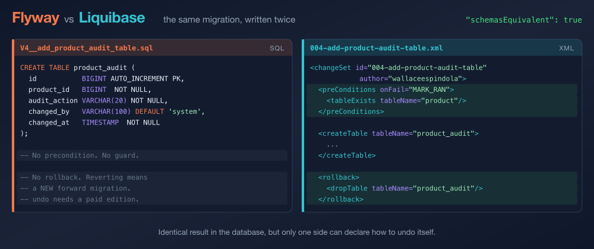
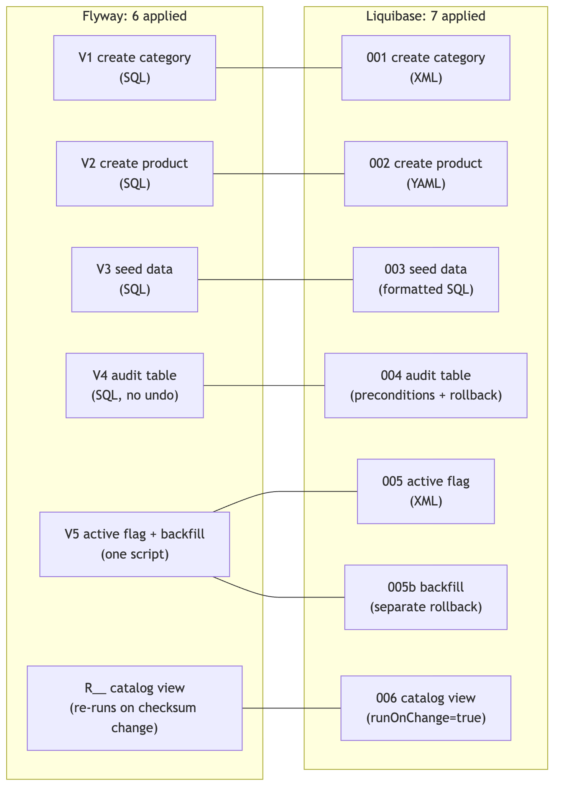

Most Flyway vs Liquibase comparisons are feature tables written from memory. They tend to agree on the broad strokes (Flyway is simpler, Liquibase does rollback) and leave out the details you only find once both tools are wired into a real application: which one records how long a migration took, which one records who wrote it, and how you read the history back from inside the app.

So I built the comparison as code. One Spring Boot application, two H2 databases, the same logical schema written once for each engine, and an endpoint that reads both schemas back from `INFORMATION_SCHEMA` and reports whether they match. The full project is here: [flyway-vs-liquibase-db-migrations on GitHub](https://github.com/wallaceespindola/flyway-vs-liquibase-db-migrations).

This article covers the hands-on part: the files you add for each engine, how they are wired without auto-configuration, and the commands to check the result yourself. Every snippet is copied from the repo, trimmed where noted.

## What you are building

The stack is Java 25, Spring Boot 4.1.2, plain JDBC and Maven. The engine versions come from the Spring Boot BOM rather than from pinned properties, so both tools are on whatever Spring Boot itself tests: Flyway 12.4.0, Liquibase 5.0.4 and H2 2.4.240.


The rule the whole project rests on: `./data/flywaydb` belongs to Flyway, `./data/liquibasedb` belongs to Liquibase, and neither engine ever touches the other's database. If both ran against one database, the second engine would find the tables already there and the comparison would mean nothing.

## Step 1: turn off DataSource auto-configuration

Spring Boot is happy to configure one `DataSource` and one migration engine for you. Two of each is where that stops being helpful, and hiding the bootstrap would also hide half of what the comparison is about. So `application.yml` excludes the auto-configuration and declares two datasource blocks under a custom `app` prefix (trimmed):

```yaml
spring:
  autoconfigure:
    exclude:
      - org.springframework.boot.jdbc.autoconfigure.DataSourceAutoConfiguration

app:
  datasource:
    flyway:
      url: jdbc:h2:file:./data/flywaydb;DB_CLOSE_DELAY=-1;AUTO_SERVER=TRUE;NON_KEYWORDS=VALUE
      driver-class-name: org.h2.Driver
      username: sa
      password: ""
    liquibase:
      url: jdbc:h2:file:./data/liquibasedb;DB_CLOSE_DELAY=-1;AUTO_SERVER=TRUE;NON_KEYWORDS=VALUE
      driver-class-name: org.h2.Driver
      username: sa
      password: ""
  migration:
    flyway:
      locations: classpath:db/migration
      baseline-on-migrate: true
    liquibase:
      change-log: classpath:db/changelog/db.changelog-master.yaml
      contexts: demo
      default-schema: PUBLIC
```

If you are coming from Spring Boot 3, note the package in that exclude. Spring Boot 4 split auto-configuration into modules, so `DataSourceAutoConfiguration` and `DataSourceProperties` now live in `org.springframework.boot.jdbc.autoconfigure`. The H2 console moved too: it needs the `spring-boot-h2console` dependency on the classpath.

## Step 2: wire each engine yourself

Each engine gets its own `@Configuration` class that builds a `DataSourceProperties`, a `DataSource`, the engine and a `JdbcTemplate`. Here's the Flyway bean from `FlywayConfig` (trimmed to the engine itself):

```java
@Bean(name = "flyway", initMethod = "migrate")
public Flyway flyway(@Qualifier(DATA_SOURCE) DataSource dataSource) {
    log.info("Configuring Flyway with locations={} baselineOnMigrate={}", locations, baselineOnMigrate);
    return Flyway.configure()
            .dataSource(dataSource)
            .locations(locations)
            .baselineOnMigrate(baselineOnMigrate)
            .validateOnMigrate(true)
            .cleanDisabled(true)
            .load();
}
```

And the Liquibase counterpart from `LiquibaseConfig`:

```java
@Bean("liquibase")
public SpringLiquibase liquibase(@Qualifier(DATA_SOURCE) DataSource dataSource) {
    log.info("Configuring Liquibase with changeLog={} contexts={}", changeLog, contexts);
    SpringLiquibase liquibase = new SpringLiquibase();
    liquibase.setDataSource(dataSource);
    liquibase.setChangeLog(changeLog);
    liquibase.setContexts(contexts);
    liquibase.setDefaultSchema(defaultSchema);
    liquibase.setDropFirst(false);
    liquibase.setShouldRun(true);
    return liquibase;
}
```

Flyway needs a `DataSource` and a location. Liquibase also wants a changelog entry point, contexts and a default schema. Those extra setters are what make contexts and per-environment filtering possible later on.

Both engines migrate during bean initialization: Flyway through `initMethod = "migrate"`, `SpringLiquibase` in `afterPropertiesSet()`. That creates a trap. A `JdbcTemplate` built on the same `DataSource` can be created before the migration has run, and the first query hits an empty database. The fix is one annotation per side:

```java
@Bean(JDBC_TEMPLATE)
@Primary
@DependsOn("flyway")
public JdbcTemplate flywayJdbcTemplate(@Qualifier(DATA_SOURCE) DataSource dataSource) {
    return new JdbcTemplate(dataSource);
}
```

`liquibaseJdbcTemplate` does the same with `@DependsOn("liquibase")`. With two beans of every JDBC type in the context, `@Qualifier` stops being optional. The repo keeps the bean names as constants (`FlywayConfig.JDBC_TEMPLATE`, `LiquibaseConfig.JDBC_TEMPLATE`) so the qualifier strings aren't copied around as literals, and the Flyway side is `@Primary`.

## Step 3: add the migration files, in pairs

Every Flyway migration has a deliberate Liquibase counterpart. Each pair makes the same business change, written the way that tool expects.



On the Flyway side you drop SQL files into `src/main/resources/db/migration` and the filename does the rest. `V1__create_category_table.sql` is plain H2 SQL (header comment trimmed):

```sql
CREATE TABLE category
(
    id          BIGINT AUTO_INCREMENT PRIMARY KEY,
    name        VARCHAR(100) NOT NULL,
    description VARCHAR(500),
    created_at  TIMESTAMP    NOT NULL DEFAULT CURRENT_TIMESTAMP,
    CONSTRAINT uk_category_name UNIQUE (name)
);

CREATE INDEX idx_category_name ON category (name);
```

Liquibase doesn't scan for files. You write a master changelog that includes each one, in order (header comment trimmed):

```yaml
databaseChangeLog:
  - include:
      file: db/changelog/changes/001-create-category-table.xml
  - include:
      file: db/changelog/changes/002-create-product-table.yaml
  - include:
      file: db/changelog/changes/003-seed-reference-data.sql
  - include:
      file: db/changelog/changes/004-add-product-audit-table.xml
  - include:
      file: db/changelog/changes/005-add-product-active-flag.xml
  - include:
      file: db/changelog/changes/006-product-catalog-view.xml
```

The includes mix XML, YAML and Liquibase's formatted SQL on purpose, to show all three work in one changelog. The YAML changeset 002 also shows the escape hatch: check constraints have no portable Liquibase tag, so that changeset drops to a `sql` change for them.

Look closely at V4 and 004. `V4__add_product_audit_table.sql` creates an audit table and has no way back. Its header comment says reverting means writing a new forward migration. The Liquibase changeset adds a precondition and a rollback (trimmed to the parts that matter):

```xml
<changeSet id="004-add-product-audit-table" author="wallaceespindola" context="demo">
    <!-- Schema order matters: preConditions must precede comment and the change tags. -->
    <preConditions onFail="MARK_RAN" onFailMessage="product table missing, skipping audit table">
        <tableExists tableName="product"/>
    </preConditions>

    <comment>Add the product audit trail, guarded by a precondition</comment>

    <createTable tableName="product_audit">
        <column name="id" type="BIGINT" autoIncrement="true">
            <constraints primaryKey="true" primaryKeyName="pk_product_audit" nullable="false"/>
        </column>
        <column name="product_id" type="BIGINT">
            <constraints nullable="false" foreignKeyName="fk_product_audit_product"
                         references="product(id)"/>
        </column>
    </createTable>

    <rollback>
        <dropIndex tableName="product_audit" indexName="idx_product_audit_product"/>
        <dropTable tableName="product_audit"/>
    </rollback>
</changeSet>
```

That comment inside the changeset is there because the ordering cost me a debug cycle. Liquibase validates the XML against its schema, and if `<preConditions>` comes after `<comment>`, the changelog fails to parse at startup.

The last pair is the view. Flyway's `R__product_catalog_view.sql` is a repeatable migration: no version, re-applied whenever its checksum changes. Liquibase gets the same behavior from an attribute, `runOnChange="true"` on changeset 006, so the rule lives in the changeset instead of the filename.

## Step 4: run it

You need Java 25 and Maven 3.9 or newer. H2 is embedded, so there's nothing else to install:

```bash
git clone https://github.com/wallaceespindola/flyway-vs-liquibase-db-migrations.git
cd flyway-vs-liquibase-db-migrations
./start.sh
```

`start.sh` builds the jar if needed, starts the app in the background and waits for the health check. Use `./start.sh --clean` to delete both databases first and watch every migration run from scratch, `./stop.sh` to shut down, and `make help` for the Makefile equivalents. Swagger UI is at `http://localhost:8080/swagger-ui.html` and the H2 console at `/h2-console`.

Then ask for the comparison:

```bash
curl -s http://localhost:8080/api/v1/comparison | jq
```

Here's what I got on a clean start, trimmed to one migration per engine and one feature row (timestamps and timings will differ on your machine):

```json
{
  "success": true,
  "message": "Both engines produced an equivalent business schema",
  "data": {
    "flyway": {
      "engine": "FLYWAY",
      "historyTable": "flyway_schema_history",
      "appliedCount": 6,
      "pendingCount": 0,
      "upToDate": true,
      "migrations": [
        {
          "identifier": "V1",
          "description": "create category table",
          "author": "n/a",
          "checksum": "-1250524602",
          "executionTimeMs": 5,
          "status": "Success"
        }
      ]
    },
    "liquibase": {
      "engine": "LIQUIBASE",
      "historyTable": "DATABASECHANGELOG",
      "appliedCount": 7,
      "pendingCount": 0,
      "upToDate": true,
      "migrations": [
        {
          "identifier": "001-create-category-table::wallaceespindola",
          "description": "Create the category reference table",
          "author": "wallaceespindola",
          "checksum": "9:0d75bd8afd86057e8d2484d044a2f1ca",
          "executionTimeMs": null,
          "status": "EXECUTED"
        }
      ]
    },
    "schemasEquivalent": true,
    "schemaDifferences": [],
    "featureMatrix": [
      {
        "feature": "Execution timing recorded",
        "flyway": "Yes, per migration, in milliseconds",
        "liquibase": "No per-changeset duration is persisted",
        "edge": "FLYWAY"
      }
    ]
  },
  "timestamp": "2026-11-17T23:45:16.296765Z"
}
```

Three things to look at. `schemasEquivalent: true` with an empty `schemaDifferences` means both engines produced the same tables, columns and views. The applied counts are 6 and 7, because V5 adds the `active` column and backfills it in one script while Liquibase splits that into `005` (the column, labeled `schema-evolution`) and `005b` (the backfill, labeled `data-backfill`), each with its own rollback. And the history rows differ in shape: Flyway has a duration but no author, Liquibase has an author but `executionTimeMs: null`.

The null is kept in the JSON on purpose (Jackson is configured to include nulls). Liquibase does log "ran successfully in 3ms" for each changeset at startup, but it doesn't write that duration to `DATABASECHANGELOG`, so there's nothing to read back later.

## Step 5: read the history back from inside the app

This is where the two implementations of `MigrationHistoryProvider` look nothing alike. `FlywayHistoryService` asks Flyway (trimmed):

```java
MigrationInfo[] all = flyway.info().all();
log.debug("Flyway reported {} known migrations", all.length);

List<AppliedMigration> applied = Arrays.stream(all)
        .filter(info -> info.getInstalledOn() != null)
        .map(FlywayHistoryService::toAppliedMigration)
        .sorted(Comparator.comparing(AppliedMigration::appliedAt))
        .toList();
```

`flyway.info()` returns applied and pending migrations as objects, ordered, with state and checksum. Liquibase has no equivalent lightweight read API when you embed it, so `LiquibaseHistoryService` queries the bookkeeping table directly:

```java
private static final String HISTORY_QUERY =
        """
        SELECT ID, AUTHOR, FILENAME, DATEEXECUTED, ORDEREXECUTED, EXECTYPE,
               MD5SUM, DESCRIPTION, COMMENTS, CONTEXTS, LABELS, DEPLOYMENT_ID
        FROM DATABASECHANGELOG
        ORDER BY ORDEREXECUTED
        """;
```

I kept both shapes instead of hiding them behind something clever. The SQL route is the finding: on the Liquibase side, the table is the interface. In exchange, that table carries author, contexts, labels and deployment id, none of which exist in `flyway_schema_history`.

A few more endpoints if you want to poke around:

```bash
curl -s http://localhost:8080/api/v1/migrations/liquibase | jq '.data.migrations[].identifier'
curl -s http://localhost:8080/api/v1/migrations/flyway/schema | jq
curl -s http://localhost:8080/api/v1/catalog/liquibase | jq
curl -s http://localhost:8080/api/v1/comparison/features | jq
```

The last one returns the 18-row feature matrix on its own.

## Troubleshooting

**Flyway warns about H2:** Flyway 12.4.0 logs that H2 2.4.240 is newer than the version it was verified with (2.3.232). Everything works. I left both versions to the Spring Boot BOM rather than pinning one, because pinning takes the project off the set Spring Boot tests together.

**Liquibase fails to parse the changelog:** check element order inside the changeset. `<preConditions>` goes before `<comment>` and before any change tags.

**Queries hit empty tables:** a `JdbcTemplate` is missing its `@DependsOn` on the engine bean.

**The diff reports index differences:** it won't, by design. `ComparisonService.diff()` compares tables, views and columns and ignores indexes, because H2 generates names for constraint-backing indexes and those names differ between the two engines. Counting them would report noise as drift.

**You added a migration and a test failed:** you added it to one side only. The integration test asserts `schemasEquivalent` and the exact applied counts, so a new `V6` needs its `007` changeset, and the 6 and 7 in the tests move together.

## Licensing, before you pick one

The rollback in changeset 004 is free, but check what "free" means now. With [Liquibase 5.0](https://docs.liquibase.com/community/release-notes/5-0), Liquibase Community moved from Apache 2.0 to the [Functional Source License](https://www.liquibase.com/blog/liquibase-community-for-the-future-fsl) (FSL-1.1-ALv2), which converts to Apache 2.0 after two years. Liquibase's own FAQ calls it source available, not OSI open source, and contributors now sign a CLA. The commercial product is Liquibase Secure, formerly Pro. Whether that matters depends on how you use and distribute it, so ask whoever signs off on licenses before you standardize on it.

On the Flyway side, undo migrations aren't in Community. Per Redgate's [feature summary](https://documentation.red-gate.com/fd/feature-summary-165740620.html) they're a paid-edition feature (Enterprise can also generate undo scripts for you). In Community, reverting means a new forward migration, which is exactly what the V4 comment says.

## Recap

- Two databases, one per engine, so neither tool ever sees the other's tables.
- Explicit `FlywayConfig` and `LiquibaseConfig`, DataSource auto-configuration excluded, `@DependsOn` so nothing queries an unmigrated database.
- Paired migration files: V1 to V5 plus `R__` against 001 to 006 plus `005b`, which is why the counts are 6 and 7.
- `GET /api/v1/comparison` returns `schemasEquivalent: true`, and the project's 86 tests (98.8% line coverage, 80% JaCoCo gate) keep it that way.
- History reads differ: `flyway.info()` against a `SELECT` on `DATABASECHANGELOG`.

## Try it yourself

Clone [the repo](https://github.com/wallaceespindola/flyway-vs-liquibase-db-migrations), run `./start.sh --clean`, and open `http://localhost:8080/` for the dashboard or curl the comparison endpoint. Then break it on purpose: add a column in a new `V6` without the Liquibase counterpart, restart, and watch `schemaDifferences` fill up.

Which of the two does your team run today, and has the rollback or the licensing question actually changed a decision for you? I'd like to hear in the comments.

**Examples repository:** the Spring Boot application, both sets of migration files, the comparison endpoints, the tests and the diagrams from this article are all in <https://github.com/wallaceespindola/flyway-vs-liquibase-db-migrations>.

Need more tech insights?
Check out my GitHub, LinkedIn, and Speaker Deck.
Happy coding!

Wallace Espindola, Solution Architect

- GitHub: <https://github.com/wallaceespindola/>
- LinkedIn: <https://www.linkedin.com/in/wallaceespindola/>
- Speaker Deck: <https://speakerdeck.com/wallacese>
