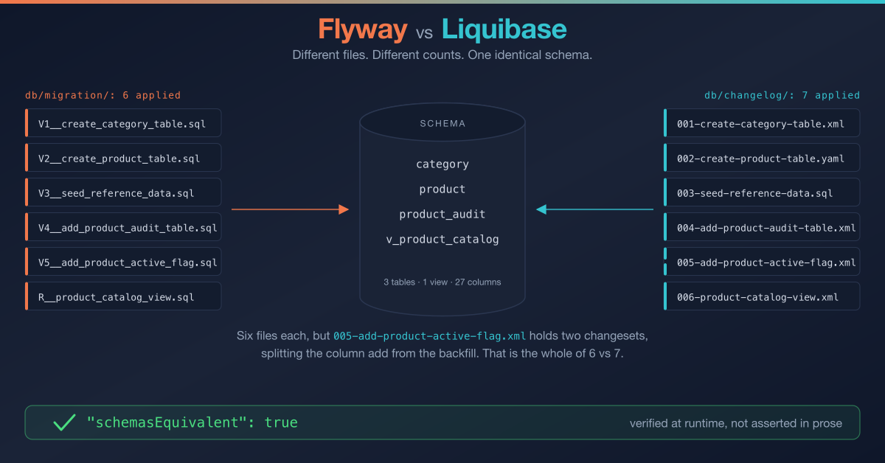
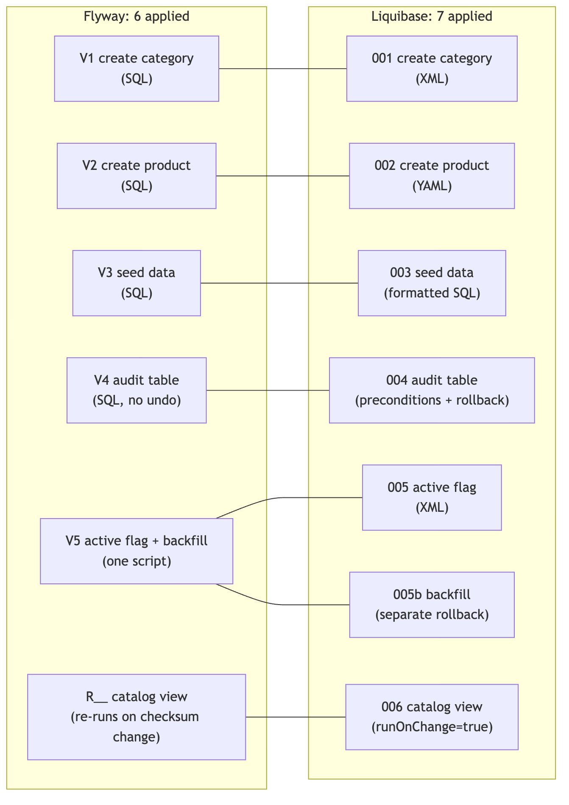

<!-- Author: rewrite this fully in your own words before submitting to DZone. -->

# Database migrations as a platform standard: governing Flyway and Liquibase



**Author**: Wallace Espindola, Solution Architect
**LinkedIn**: <https://www.linkedin.com/in/wallaceespindola/>
**GitHub**: <https://github.com/wallaceespindola/>
**Companion repo**: <https://github.com/wallaceespindola/flyway-vs-liquibase-db-migrations>

---

At some point a platform team gets asked to pick one schema migration tool for every service in the company. Often the request follows an incident: a migration ran twice, a rollback was improvised at 2 a.m., or an auditor asked who changed a table and nobody could answer from the database alone. The choice is almost always Flyway or Liquibase, and it is almost always made from a feature table.

I don't think a feature table is enough for that decision, so I built a [companion repository](https://github.com/wallaceespindola/flyway-vs-liquibase-db-migrations) that builds the same schema twice, once with each engine, and diffs the results at runtime. This article is the governance side of that experiment. It covers what a platform team should standardize, where the review and CI gates sit, how to write a rollback policy, what the history tables give an auditor and why licensing belongs in the procurement checklist. It is not a tutorial on either tool, and I don't have adoption numbers from a company-wide rollout to report. What I have is a runnable baseline that every claim below can be checked against.

## The evidence base: one schema, two engines

The project is a Spring Boot 4.1.2 application on Java 25 with plain JDBC. It runs two H2 file databases: `./data/flywaydb` belongs to Flyway and `./data/liquibasedb` belongs to Liquibase. Neither engine ever touches the other's database. Both target the same business schema: a `category` table, a `product` table, a `product_audit` table and a `v_product_catalog` view. Engine versions come from the Spring Boot BOM rather than being pinned: Flyway 12.4.0, Liquibase 5.0.4 and H2 2.4.240.


After startup, `ComparisonService` reads both schemas back from `INFORMATION_SCHEMA` and compares tables, columns and views. Here's the headline payload, trimmed from the repo README:

```json
{
  "schemasEquivalent": true,
  "schemaDifferences": [],
  "flyway":    { "appliedCount": 6, "historyTable": "flyway_schema_history" },
  "liquibase": { "appliedCount": 7, "historyTable": "DATABASECHANGELOG" }
}
```

Both engines land on the same business schema. For governance that moves the debate. With an equal schema outcome, the decision comes down to everything around it: the review experience, the rollback story, the audit trail and the license. Those are exactly the things a platform standard has to pin down.

## What a platform standard actually has to fix

A migration standard is more than "we use Flyway". In my view it has to answer five questions for every service:

- **Engine and layout:** which tool, which folder, which file naming rule.
- **Bootstrap:** how the engine is wired into the application and which safety switches are mandatory.
- **Review:** what a reviewer must check in a migration pull request.
- **Rollback:** whether a change must declare how it is undone, or whether every fix moves forward.
- **Audit and licensing:** what the history table must answer, and which edition of the tool the company is entitled to use.

The repo wires both engines explicitly instead of relying on `spring.flyway.*` or `spring.liquibase.*` auto-configuration. `DataSourceAutoConfiguration` is excluded, and `FlywayConfig` and `LiquibaseConfig` each build their own `DataSource`, engine and `JdbcTemplate`. For a demo this makes the bootstrap cost visible. For a platform team it shows where the policy switches live. Here's the Flyway bean, trimmed from `FlywayConfig.java` (the log line is removed):

```java
@Bean(name = "flyway", initMethod = "migrate")
public Flyway flyway(@Qualifier(DATA_SOURCE) DataSource dataSource) {
    return Flyway.configure()
            .dataSource(dataSource)
            .locations(locations)
            .baselineOnMigrate(baselineOnMigrate)
            .validateOnMigrate(true)
            .cleanDisabled(true)
            .load();
}
```

Two of those lines are policy settings. `validateOnMigrate(true)` makes Flyway refuse to run when an applied script's checksum no longer matches the file, so an edited migration fails the deploy instead of drifting quietly. `cleanDisabled(true)` removes the one command that drops every object in the schema. I'd make both mandatory in a shared starter or a parent configuration, so no service can switch them off by accident.

The Liquibase side has the same kind of switches, trimmed from `LiquibaseConfig.java`:

```java
@Bean("liquibase")
public SpringLiquibase liquibase(@Qualifier(DATA_SOURCE) DataSource dataSource) {
    SpringLiquibase liquibase = new SpringLiquibase();
    liquibase.setDataSource(dataSource);
    liquibase.setChangeLog(changeLog);
    liquibase.setContexts(contexts);
    liquibase.setDefaultSchema(defaultSchema);
    liquibase.setDropFirst(false);
    liquibase.setShouldRun(true);
    return liquibase;
}
```

`setDropFirst(false)` is the equivalent of disabling clean. `setContexts(contexts)` is the more interesting one for governance, because contexts decide which changesets run in which environment. If contexts are part of your model, the list of allowed context names belongs in the standard. Otherwise each team invents its own and nobody can tell which changes ran in production.

One wiring detail belongs in any standard that embeds the engine in the application. Both `JdbcTemplate` beans are annotated with `@DependsOn` on their engine bean, so no query can reach a database before its migrations have run. Without it you get a startup race that only shows up under load.

## The review gate: what a reviewer sees in the diff

The review gate is where the two tools differ most for day-to-day work. Flyway discovers migrations by convention: it scans `classpath:db/migration`, reads the version from the file name and applies them in order. Liquibase uses an explicit manifest. Here's the master changelog from the repo, with its header comment removed:

```yaml
databaseChangeLog:
  - include:
      file: db/changelog/changes/001-create-category-table.xml
  - include:
      file: db/changelog/changes/002-create-product-table.yaml
  - include:
      file: db/changelog/changes/003-seed-reference-data.sql
  - include:
      file: db/changelog/changes/004-add-product-audit-table.xml
  - include:
      file: db/changelog/changes/005-add-product-active-flag.xml
  - include:
      file: db/changelog/changes/006-product-catalog-view.xml
```

That difference changes how conflicts show up in review. With Flyway, two branches that both add `V6__` produce a duplicate version, and Flyway fails on it. The failure is loud and early. With Liquibase, two branches both append an `include` line to the master changelog. Git flags the conflict, but a wrong resolution can drop one include, and nothing fails until someone notices a changeset never ran. So if you standardize on Liquibase, the review checklist needs an explicit line: "every new changeset file is included exactly once".

The reviewer's reading load also differs. Flyway Community migrations are SQL, which every reviewer already reads. Liquibase lets one changelog mix XML, YAML, JSON and SQL, and the repo uses three formats on purpose to show it. Abstract tags such as `createTable` buy dialect portability, because Liquibase generates the SQL for the target database at runtime. The price is that a reviewer has to know what each tag emits. If your teams all run on one database engine, I'd restrict Liquibase changesets to one format (formatted SQL or XML) in the standard and stop there.



The pairing above is also a convention a standard can enforce. Every Flyway migration in the repo has a Liquibase counterpart, and the applied counts are 6 against 7 because Liquibase splits V5 into a schema change (`005`) and a data backfill (`005b`). The split is deliberate, and it leads straight into rollback policy.

## Rollback policy: decide it before the tool decides for you

Every migration standard needs one sentence on rollback, and the tool you pick shapes that sentence more than people expect.

Flyway Community has no undo. Undo migrations exist, but [Redgate's feature summary](https://documentation.red-gate.com/fd/feature-summary-165740620.html) lists them only for the paid editions. On Community, reverting means writing a new forward migration. The repo's `V4__add_product_audit_table.sql` has no undo path at all, and its header comment points the reader to a hypothetical `V6__drop_product_audit_table.sql` as the way back. Here's the start of the file, trimmed:

```sql
-- Flyway V4: add an audit trail table.
CREATE TABLE product_audit
(
    id           BIGINT AUTO_INCREMENT PRIMARY KEY,
    product_id   BIGINT       NOT NULL,
    audit_action VARCHAR(20)  NOT NULL,
    changed_by   VARCHAR(100) NOT NULL DEFAULT 'system',
    changed_at   TIMESTAMP    NOT NULL DEFAULT CURRENT_TIMESTAMP,
    CONSTRAINT fk_product_audit_product FOREIGN KEY (product_id) REFERENCES product (id)
);
```

The Liquibase counterpart declares both a guard and an undo path. This is trimmed from `004-add-product-audit-table.xml`, with the column list removed:

```xml
<changeSet id="004-add-product-audit-table" author="wallaceespindola" context="demo">
    <!-- Schema order matters: preConditions must precede comment and the change tags. -->
    <preConditions onFail="MARK_RAN" onFailMessage="product table missing, skipping audit table">
        <tableExists tableName="product"/>
    </preConditions>

    <comment>Add the product audit trail, guarded by a precondition</comment>

    <createTable tableName="product_audit">
        <!-- columns trimmed -->
    </createTable>

    <rollback>
        <dropIndex tableName="product_audit" indexName="idx_product_audit_product"/>
        <dropTable tableName="product_audit"/>
    </rollback>
</changeSet>
```

From a governance angle this changeset carries two separate policies.

The `<rollback>` block makes `liquibase rollbackCount 1` an operation you can rehearse in a lower environment before you ever need it. If your standard says "every changeset declares its rollback", a reviewer can check that mechanically. Liquibase infers rollback for many change types on its own, but data changes and raw `<sql>` blocks need an explicit one.

The precondition is the part I'd treat with more care. `onFail="MARK_RAN"` means that when `product` doesn't exist, the changeset is recorded as run without doing anything. That keeps a deploy alive across environments that drifted apart, which is useful. It also writes a history row for a change that never happened. So a standard should say which `onFail` values are allowed. I'd allow `HALT` by default and require a reviewer's sign-off for `MARK_RAN`, because it trades a failed deploy for a silent gap.

The `005` and `005b` split is the third policy. V5 in Flyway adds the `active` column and backfills it in one script. Liquibase puts the schema change and the data backfill into separate changesets, labelled `schema-evolution` and `data-backfill`, each with its own rollback. A rule like "schema and data changes never share a changeset" is cheap to write down, and it makes partial rollback possible. With Flyway you can follow the same rule by splitting the work into two versioned scripts. You just don't get the label filtering.

My rule of thumb for the policy sentence:

- **Flyway Community:** "We fix forward. Every destructive change is preceded by a backup step, and the reverting migration is written and reviewed with the original."
- **Liquibase:** "Every changeset declares a rollback, data changes are separate changesets, and `rollbackCount` runs in staging before release."
- **Flyway paid editions:** undo becomes available, and the policy can look more like the Liquibase one. That makes it a licensing decision as much as a technical one.

## History and audit: what the database remembers

Auditors usually ask two questions: what changed and who changed it. The two history tables answer them differently, and the repo shows it in code.

Flyway exposes its history through an in-process API. `FlywayHistoryService` calls `flyway.info()` and maps each `MigrationInfo`, trimmed from the repo:

```java
return new AppliedMigration(
        identifier,
        info.getDescription(),
        info.getScript(),
        info.getType().name(),
        NO_AUTHOR,
        Objects.toString(info.getChecksum(), null),
        info.getInstalledOn().toInstant(),
        info.getExecutionTime() < 0 ? null : (long) info.getExecutionTime(),
        info.getState().getDisplayName());
```

Liquibase has no equivalent embedded read API, so `LiquibaseHistoryService` queries `DATABASECHANGELOG` directly:

```java
private static final String HISTORY_QUERY =
        """
        SELECT ID, AUTHOR, FILENAME, DATEEXECUTED, ORDEREXECUTED, EXECTYPE,
               MD5SUM, DESCRIPTION, COMMENTS, CONTEXTS, LABELS, DEPLOYMENT_ID
        FROM DATABASECHANGELOG
        ORDER BY ORDEREXECUTED
        """;
```

Three findings fall out of those two snippets.

First, authorship. Flyway records no author (`NO_AUTHOR` is the string `n/a`), so "who" lives only in version control. Liquibase makes `author` a mandatory attribute of every changeset. Keep in mind that the value is whatever the developer typed into the file. It identifies the author of the change, not the identity that deployed it, and it isn't authenticated. If your auditors need the deployer, you still need pipeline logs.

Second, timing. Flyway persists execution time per migration. Liquibase stores no duration at all, so the repo returns `"executionTimeMs": null` for every Liquibase row. Jackson is configured to keep nulls on purpose, because the missing value is a finding. If a standard requires migration duration for capacity planning, a Liquibase shop has to capture it elsewhere.

Third, context. `DATABASECHANGELOG` records contexts, labels, deployment ID and execution type, none of which Flyway tracks. For a regulated environment that wants to answer "which changes ran in this deployment, under which context", the Liquibase table answers more on its own.

For a platform team, the practical consequence is that a status dashboard or a compliance export is cheap to build on Flyway (one API call) and needs SQL against an internal table on Liquibase. That table is effectively a public interface, so its schema becomes something you track across Liquibase upgrades.

## Turning equivalence into a CI gate

The most reusable governance idea in the repo is that it asserts schema equivalence in a test. `ApplicationIntegrationTest` has a nested class called `CentralClaim`. Here's its first test, copied from the repo:

```java
@Test
@DisplayName("both engines produce an equivalent business schema")
void bothEnginesProduceEquivalentSchema() {
    ComparisonReport report = comparisonService.compare();

    assertThat(report.schemaDifferences())
            .as("Flyway and Liquibase should converge on the same business schema")
            .isEmpty();
    assertThat(report.schemasEquivalent()).isTrue();
}
```

The CI workflow then checks the same claim a second time against the packaged application. This step is trimmed from `.github/workflows/ci.yml`:

```bash
curl -fsS http://localhost:8080/api/v1/comparison -o comparison.json
python3 - <<'PY'
import json, sys

with open("comparison.json") as fh:
    report = json.load(fh)["data"]

failures = []
if not report["schemasEquivalent"]:
    failures.append(f"schemas differ: {report['schemaDifferences']}")
# ... applied-count checks trimmed ...
PY
```


Most teams will never run two engines in production. The pattern still applies in three situations I'd expect a platform team to meet:

- **Moving from one tool to the other:** run both against fresh databases during the transition and fail the build on any structural difference.
- **Shipping one changelog to several databases:** run the same changelog against each target and diff the results, which turns Liquibase's portability claim into something you test.
- **Comparing environments:** diff a freshly migrated database against a snapshot of staging to catch manual hotfixes.

One caveat belongs in any such gate. `ComparisonService.diff()` deliberately ignores indexes, because H2 generates constraint-backing indexes under names that differ between the two engines. Comparing them would report noise as drift. A production gate should decide which object types it compares and say so, or it will either miss things or cry wolf.

## Licensing is a procurement gate

The last part of the standard is the one engineers like least, and it changed recently.

On the Flyway side, the gap is between Community and the paid editions. Redgate's [feature summary](https://documentation.red-gate.com/fd/feature-summary-165740620.html) lists undo migrations and dry-run scripts in the paid editions, and drift detection in Enterprise only. If your rollback policy depends on undo, you're making a purchase decision.

On the Liquibase side, the change is the license itself. With [Liquibase 5.0](https://www.liquibase.com/blog/liquibase-community-for-the-future-fsl), announced on September 30, 2025, Liquibase Community moved from Apache 2.0 to the Functional Source License (FSL-1.1-ALv2). Each version converts to Apache 2.0 two years after its release, and versions already released under Apache 2.0 stay that way. Liquibase's FAQ says FSL "may be referred to as a 'source available' or 'fair source' license", and it isn't an OSI-approved open source license. The restriction targets third parties that commercialize Liquibase in competition with Liquibase, not ordinary internal use. Contributors now sign a CLA, and the commercial product is now called Liquibase Secure. The [5.0 release notes](https://docs.liquibase.com/community/release-notes/5-0) add that Community 5.0 ships without extensions and drivers (they come through the new package manager) and requires Java 17 or later.

In this repo nobody chose Liquibase 5. The Spring Boot 4.1.2 BOM manages the version, so upgrading Spring Boot moved the project from an Apache 2.0 Liquibase to an FSL one without anyone editing a dependency line. I think that's the strongest argument for putting license checks into the build (a license scanner on the resolved dependency tree), not into a one-time procurement review. If your company's policy only allows OSI-approved licenses, that gate will now fire on Liquibase 5.x, and you need an approved exception, a pinned 4.x version or a different tool.

Either tool can still be the right choice. The license row in your decision matrix has an owner outside engineering, and that owner needs to see the version that actually ships.

## Trade-offs: where each standard fits

Standardize on **Flyway** when:

- Your teams write and review SQL comfortably and target one database engine.
- A forward-fix rollback policy is acceptable, or you're licensed for the paid editions.
- You want a status API for dashboards and health checks without querying an internal table.
- You prefer merge conflicts that fail loudly on a duplicated version number.

Standardize on **Liquibase** when:

- You ship the same schema to more than one database engine, or expect to.
- Declared, rehearsed rollback is a hard requirement and you don't want to pay for it.
- Contexts, labels and author attribution need to live in the database's own history.
- Your legal team has reviewed FSL, or you pin a pre-5.0 version and accept what that costs in fixes.

Either way, the parts I'd make non-negotiable are the same: hardened bootstrap switches, a written rollback rule, a review checklist that covers the tool's specific failure mode and an automated schema check in CI.

## Summary

- Both engines build an identical business schema in the repo, so the decision rests on review, rollback, audit and licensing.
- Put the safety switches (`validateOnMigrate`, `cleanDisabled`, `setDropFirst(false)`) and the `@DependsOn` ordering into a shared configuration so teams can't drift.
- Write the rollback policy down. Flyway Community means fix forward. Liquibase means a declared rollback per changeset, and `MARK_RAN` needs a reviewer's sign-off.
- Flyway gives you an API for history and records timing. Liquibase records author, contexts and labels, but you read it with SQL.
- Licensing changed in 2025. Scan the resolved dependency tree, because a framework upgrade can change the license for you.

The full source, both migration trees, the tests and the CI workflow are in the [companion repo](https://github.com/wallaceespindola/flyway-vs-liquibase-db-migrations). Fork it and replace the H2 URLs with your own database to see what the comparison says for your dialect.

Has your platform team written a migration standard yet? I'm curious whether others put rollback and licensing rules in it or still leave both to each service team. Let me know in the comments.

**Examples repository:** the Spring Boot application, both migration trees (6 Flyway scripts and 7 Liquibase changesets), the equivalence tests, the CI workflow and the diagrams are in <https://github.com/wallaceespindola/flyway-vs-liquibase-db-migrations>.

Need more tech insights?
Check out my GitHub, LinkedIn, and Speaker Deck.
Happy coding!

Wallace Espindola, Solution Architect

- GitHub: <https://github.com/wallaceespindola/>
- LinkedIn: <https://www.linkedin.com/in/wallaceespindola/>
- Speaker Deck: <https://speakerdeck.com/wallacese>

<!--
DZone submission metadata
TL;DR: Flyway and Liquibase build the same schema, so a platform standard should decide review gates, rollback policy, audit needs and licensing instead.
Article type: Analysis
Summary (meta description): How a platform team standardizes database migrations with Flyway or Liquibase: bootstrap switches, review gates, rollback policy, audit trail and licensing checks.
Primary zone: Databases. Additional zones: Java, DevOps, Software Design and Architecture.
Tags: flyway, liquibase, database-migrations, spring-boot, devops, governance
-->
