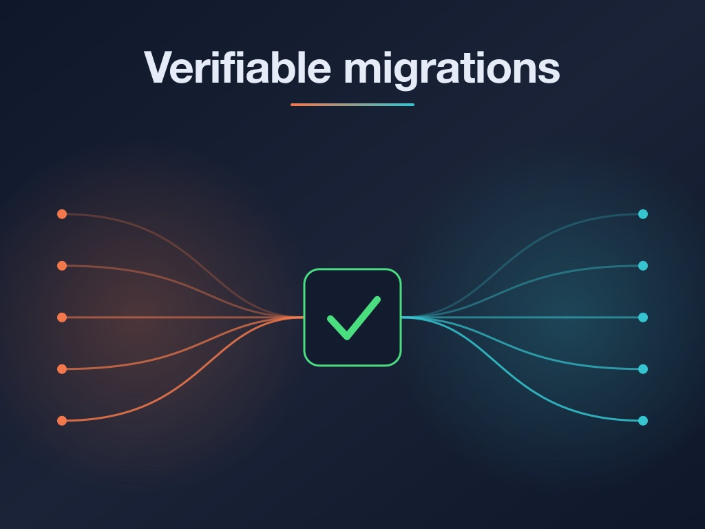

<!--
Meta description: Schema migrations are executable artifacts you can verify like code. A look at convention-based Flyway, manifest-based Liquibase and the 2025 license shift.
Tags: database migrations, Flyway, Liquibase, schema management, software architecture, open source licensing, Spring Boot
-->



# Schema Migrations as Verifiable Artifacts: Conventions, Manifests and Licenses

**Key Takeaways**

- Schema migrations have become executable artifacts that ship with the application, so their outcome can be verified in CI by comparing the schema they produce instead of reviewing scripts alone.
- Flyway and Liquibase represent two models of a change, convention-based files ordered by version and a manifest of identified changesets, and the choice shows up later in merge conflicts, review load and audit data.
- When both tools build the same schema, as they do in the reference implementation discussed here, the selection criteria move from schema capability to rollback, history, review ergonomics and licensing.
- The history table is effectively an audit interface, and the two tools record different facts: Flyway records execution time and exposes a status API on the bean Spring already holds, while Liquibase records author, contexts and labels and keeps its status API on a `Liquibase` instance that the Spring integration does not hand out.
- Liquibase Community moved to the source-available Functional Source License with version 5.0, and Flyway keeps undo and drift detection in paid editions, so licensing now belongs in architecture decisions and in automated dependency checks.

---

*By Wallace Espindola, Solution Architect · [LinkedIn](https://www.linkedin.com/in/wallaceespindola/) · [GitHub](https://github.com/wallaceespindola/)*

*Companion repository with the reference implementation, both migration trees and the equivalence tests discussed here: [github.com/wallaceespindola/flyway-vs-liquibase-db-migrations](https://github.com/wallaceespindola/flyway-vs-liquibase-db-migrations)*

---

## Where migration tool comparisons usually stop

Most comparisons of Flyway and Liquibase are feature tables. They list supported formats, rollback support, database coverage and edition boundaries, then leave the architect to weigh the rows. That answers whether a tool can do something, but it leaves open whether two approaches lead to the same database and which differences remain once they do.

This article takes a different route. It treats a set of migrations as an executable artifact whose result can be measured, and uses a small open reference implementation to measure it. The same logical schema is built twice, once by each tool, in two separate databases, and the two results are compared at runtime. The comparison makes it possible to separate what the tools have in common from what actually distinguishes them.

The analysis then looks at three trends that shape a platform decision today: the move from reviewing scripts to verifying outcomes, the split between convention-based and manifest-based migration models, and the license changes that moved governance capabilities across edition boundaries in 2025. The reference implementation uses an embedded H2 database and has not been measured in a production estate, so the article discusses design and trade-offs. It does not report adoption or performance outcomes.

## Migrations as executable artifacts

Schema changes used to be scripts that a database administrator ran by hand during a release window. Migration tools turned them into versioned files that live next to the application code and run automatically. Spring Boot's [documentation](https://docs.spring.io/spring-boot/how-to/data-initialization.html), for example, says it supports two higher-level migration tools, Flyway and Liquibase, and both tools record each applied change in a history table inside the target database.

Once migrations run as part of the application lifecycle, they share the properties of other build artifacts. They are versioned, they have checksums, they can be executed in a test environment and their result can be asserted. Both tools already use checksums to detect edits to applied changes (Flyway computes a CRC32 of the script, Liquibase an MD5 of the changeset). What is less common is asserting the result: checking the schema that a set of migrations produces, rather than checking the migrations themselves.

The reference implementation is a Spring Boot 4.1.2 application on Java 25 with plain JDBC. Engine versions come from the Spring Boot dependency BOM rather than being pinned: Flyway 12.4.0, Liquibase 5.0.4 and H2 2.4.240. Two H2 file databases are used, `./data/flywaydb` owned by Flyway and `./data/liquibasedb` owned by Liquibase, and neither engine touches the other's database. Both target the same business schema: three tables (`category`, `product`, `product_audit`) and one view (`v_product_catalog`).

## Two models of a change: convention and manifest

The two tools disagree on what a change is and how it is found.

Flyway is convention-based. It scans a location, `classpath:db/migration` in the reference implementation, and derives identity and order from the file name. `V1__create_category_table.sql` through `V5__add_product_active_flag.sql` form a single ordered namespace, and `R__product_catalog_view.sql` is a repeatable migration that runs again whenever its checksum changes. There is no list of files to maintain, because the directory listing is the list.

Liquibase is manifest-based. A master changelog names the files to include, in order, and each file contains one or more changesets. A changeset is identified by the combination of its `id`, its `author` and its file name, not by a position in a sequence. The reference implementation's master changelog includes six files in three formats (XML, YAML and Liquibase's formatted SQL), and one of them holds two changesets.


*Figure 1: How each model finds and orders changes, and where concurrent work collides. Blue: discovery steps. Red: the merge-conflict profile of each model.*

The models produce different failure modes when two branches add a change at the same time. In the convention model, both branches tend to pick the next version number, and Flyway refuses to run with a duplicate version. The conflict is visible and immediate. In the manifest model, both branches append an `include` line to the master changelog. Version control reports a textual conflict, but a wrong resolution can drop one of the includes, and nothing fails until someone notices that a changeset never ran. Neither profile is fatal, but each calls for its own review checklist.

The models also distribute review effort differently. Convention-based Flyway Community migrations are SQL in the target dialect, which every reviewer can read but which must be rewritten for another database engine. Manifest-based Liquibase changesets can use abstract change types such as `createTable` and `addColumn`, which Liquibase translates into the target dialect at runtime. That buys portability across engines and moves knowledge into the tool: a reviewer has to know what each change type emits. The reference implementation shows where the abstraction ends, too. Its YAML changeset for the `product` table falls back to an inline SQL block for check constraints.

The models diverge again on granularity. Flyway's `V5` adds the `active` column and backfills it in one script. Liquibase splits the same logical change into `005` (the schema change, labelled `schema-evolution`) and `005b` (the data backfill, labelled `data-backfill`), each with its own rollback. That is why the reference implementation applies 6 Flyway migrations and 7 Liquibase changesets for the same end state. Flyway can express the same split with two versioned scripts, but it has no equivalent of labels to filter them by.

## Verifying the outcome instead of the scripts

If migrations are artifacts, the strongest check is on what they produce. The reference implementation reads both databases back from `INFORMATION_SCHEMA`, excludes each tool's bookkeeping tables (`flyway_schema_history`, `DATABASECHANGELOG` and `DATABASECHANGELOGLOCK`), and compares the rest structurally. The comparison is a short method in `ComparisonService`, shown here without its Javadoc:

```java
static List<String> diff(SchemaSnapshot flyway, SchemaSnapshot liquibase) {
    List<String> differences = new ArrayList<>();
    compareSets("table", flyway.tables(), liquibase.tables(), differences);
    compareSets("view", flyway.views(), liquibase.views(), differences);
    compareSets("column", flyway.columns(), liquibase.columns(), differences);
    return List.copyOf(differences);
}
```

Each difference is reported by name, for example a column that exists on one side and not on the other. An empty list means the two schemas are equivalent for the object types compared. The application exposes the result at `GET /api/v1/comparison`, and for the reference schema it reports `schemasEquivalent: true` with zero structural differences.


*Figure 2: The verification loop used in the reference implementation. Amber: source artifacts. Blue: execution and inspection. Green and red: build outcomes.*

The claim is enforced twice. An integration test asserts that the list of differences is empty, and the CI workflow boots the packaged application, calls the comparison endpoint and fails the build if `schemasEquivalent` is false. Changing a migration on one side without its counterpart therefore breaks the build, which is the intended behavior.

The comparison has a defined scope. Indexes are deliberately excluded, because H2 generates constraint-backing indexes under names that differ between the two tools, and comparing them would report naming noise as drift. Any team adopting this pattern has to make the same decision explicitly: which object types are compared, and which are known to differ for reasons that do not matter.

The pattern has uses beyond comparing two tools, which few teams do in production. It applies when a team migrates from one tool to the other and needs evidence that the new changelog reproduces the old schema, when a single Liquibase changelog targets several database engines and its portability needs to be tested rather than assumed, and when a freshly migrated database is compared with a long-lived environment to detect manual changes.

## History tables as an audit interface

Every migration tool keeps a history table, and in regulated environments auditors can ask what it contains. The two tools record different facts and expose them differently, and the reference implementation needs two different implementations of the same `MigrationHistoryProvider` interface to read them.

Flyway exposes history through an in-process API. `flyway.info()` returns applied and pending migrations as `MigrationInfo` objects with version, description, checksum, state and execution time already attached, so the Flyway implementation needs no SQL. Flyway records no author, but its `installed_by` column, exposed as `MigrationInfo.getInstalledBy()`, records the database user that applied each migration.

Liquibase does have a status API. The `Liquibase` class offers `getChangeSetStatuses()`, `listUnrunChangeSets()` and `reportStatus()`, but they need an instance built from the changelog plus an open database connection. `SpringLiquibase`, which runs the update at startup, does not hand that object out, so the Liquibase implementation queries `DATABASECHANGELOG` directly. The asymmetry comes from what each Spring integration exposes, not from a missing Liquibase API. The table records more context than Flyway's: author, file name, contexts, labels, deployment ID and execution type. It records no duration, so the reference implementation reports a null execution time for every Liquibase changeset. It also records only what has already run, so listing pending changesets means going through that status API rather than the table.

Two consequences follow for architects. First, the Liquibase history table becomes a de facto public interface, so its schema has to be tracked across Liquibase upgrades. Second, the author attribute should not be over-read. It is the value written in the changeset file, which identifies who wrote the change. Liquibase does not record who deployed it, so deployment identity has to come from pipeline logs.

## The license shift in the category

In 2025 the biggest change in this category came from licensing.

On September 30, 2025, Liquibase [announced](https://www.liquibase.com/blog/liquibase-community-for-the-future-fsl) that Liquibase Community would move from Apache 2.0 to the Functional Source License (FSL-1.1-ALv2) starting with version 5.0. According to the announcement, each version reverts to Apache 2.0 two years after its release, versions previously released under Apache 2.0 keep that license and contributors now sign a one-time Contributor License Agreement. The restriction is aimed at third parties that "commercialize it in a way that competes with Liquibase". Liquibase's FAQ notes that FSL "may be referred to as a 'source available' or 'fair source' license", and FSL is not an OSI-approved open source license. The [FSL project](https://fsl.software/) summarizes the intent as "You can do anything with FSL software except undermine its producer". The commercial product is now called Liquibase Secure. The [5.0 release notes](https://docs.liquibase.com/community/release-notes/5-0) add two operational changes: Community 5.0 "ships without extensions, drivers, and many other packages and dependencies", which are installed through a new package manager, and the minimum Java version is 17.

Flyway's edition boundary has a different shape. Its [feature summary](https://documentation.red-gate.com/fd/feature-summary-165740620.html) lists undo migrations and dry-run scripts for the paid Teams and Enterprise editions, and drift detection for Enterprise only. The Community edition remains forward-only: reverting a change means writing a new migration.

| Capability | Flyway Community | Flyway paid editions | Liquibase Community 5.x (FSL) |
| --- | --- | --- | --- |
| Declared rollback or undo | No, fix forward | Undo migrations | Built in, per changeset |
| Dry run | No | Dry-run scripts | `update-sql` prints the SQL without running it |
| Drift detection or diff | No | Enterprise only | `diff` and `diffChangeLog` |
| OSI-approved license | Yes | Commercial | No, source available |

Taken together, the two vendors draw the line in different places. Flyway keeps its core open source and charges for capabilities that matter most to governance, such as undo and drift detection. Liquibase keeps rollback and diff in Community and changes the license of the Community code itself. For an architect, both patterns mean the same thing: the license is now an input to the architecture decision, alongside the feature set.

A license can also change without anyone deciding to change it. In the reference implementation nobody selected Liquibase 5. The Spring Boot 4.1.2 BOM manages the version, so a framework upgrade moved the project from an Apache 2.0 release to an FSL release without any change to a dependency declaration. Organizations whose policy allows only OSI-approved licenses need a license check on the resolved dependency tree in CI, because a one-time procurement review would not see this change.

## Implications for platform choices

When the schema outcome is equal, the decision rests on how a platform team wants to govern change.

- **Rollback policy:** a forward-only policy fits Flyway Community. A policy that requires declared, rehearsed rollback fits Liquibase Community or a paid Flyway edition, and the choice between those two is partly a licensing decision.
- **Database portability:** if a schema has to run on more than one engine, the manifest model with abstract change types is the more direct fit, and the verification loop above is how to test the portability claim.
- **Review and conflicts:** teams that review SQL comfortably and prefer conflicts that fail early tend to fit the convention model. Teams that choose the manifest model need a review rule for the include list.
- **Audit and observability:** Flyway's status API and recorded timings suit dashboards and health checks. Liquibase's author, context and label columns suit environments that need richer attribution in the database itself.
- **License policy:** organizations restricted to OSI-approved licenses need either an approved exception for Liquibase 5.x, a pinned 4.x release with the maintenance cost that implies, or Flyway.

Whichever tool is chosen, the verification idea carries over: run the migrations against a clean database in CI, inspect the result and fail the build on an unexpected structural difference.

## Limitations of this analysis

The reference implementation uses H2 only. It demonstrates equivalence for one schema on one engine, so the portability argument for Liquibase is described, not tested, here. Flyway 12.4.0 logs a warning that H2 2.4.240 is newer than the latest H2 version it has verified (2.3.232). Everything works, but the combination is outside Flyway's tested set. The schema is small (three tables and a view), and the comparison deliberately ignores indexes. The feature descriptions for paid editions come from vendor documentation rather than from running those editions.

## Conclusion

Treating migrations as executable artifacts changes how the Flyway and Liquibase question is framed. Built against the same schema, the two tools converge on the same result, so the useful comparison is about the model of a change, the review and conflict profile, the audit data each tool keeps and the license under which each capability is available. The licensing changes of 2025 make the last point harder to leave to procurement alone, because a routine framework upgrade can change the license of a dependency.

Teams that already run migrations in CI are one step away from verifying their outcome. How does your organization currently decide which migration tool and edition a service may use, and is the license part of that decision?

## References

- Liquibase, [Strengthening Liquibase Community for the Future](https://www.liquibase.com/blog/liquibase-community-for-the-future-fsl), September 30, 2025
- Liquibase Docs, [Liquibase 5.0 release notes](https://docs.liquibase.com/community/release-notes/5-0), September 2025
- Functional Source License, [fsl.software](https://fsl.software/)
- Redgate, [Flyway feature summary](https://documentation.red-gate.com/fd/feature-summary-165740620.html)
- Spring Boot Docs, [Database initialization](https://docs.spring.io/spring-boot/how-to/data-initialization.html)
- Open Source Initiative, [The Open Source Definition](https://opensource.org/osd)
- Companion repository with the reference implementation, both migration trees, the equivalence tests and the CI workflow: [github.com/wallaceespindola/flyway-vs-liquibase-db-migrations](https://github.com/wallaceespindola/flyway-vs-liquibase-db-migrations)

## About the author

**Wallace Espindola, Solution Architect**

Wallace Espindola is a software engineer and solution architect working across Java/Spring Boot and Python/FastAPI backends, cloud-native microservices on Kubernetes and OpenShift, relational and NoSQL databases and system architecture design. He maintains the open repository behind this article, a Spring Boot application that builds the same schema with Flyway and Liquibase and compares the results at runtime.

**Examples repository:** the Spring Boot reference implementation, the 6 Flyway migrations and 7 Liquibase changesets, the schema equivalence tests, the CI workflow and the diagrams are in <https://github.com/wallaceespindola/flyway-vs-liquibase-db-migrations>.

Need more tech insights?
Check out my GitHub, LinkedIn, and Speaker Deck.
Happy coding!

Wallace Espindola, Solution Architect

- GitHub: <https://github.com/wallaceespindola/>
- LinkedIn: <https://www.linkedin.com/in/wallaceespindola/>
- Speaker Deck: <https://speakerdeck.com/wallacese>

<!--
Publishing note for the author: this article is submitted for InfoQ's 4-week exclusive publishing window.
Do not cross-post it to other platforms until that window closes. Declare any AI tool use in the InfoQ submission form, not in the article text.
-->
