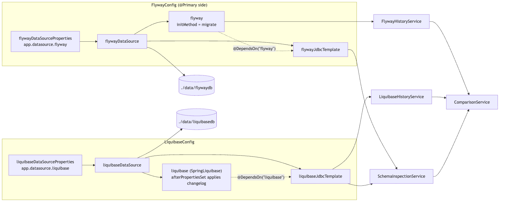
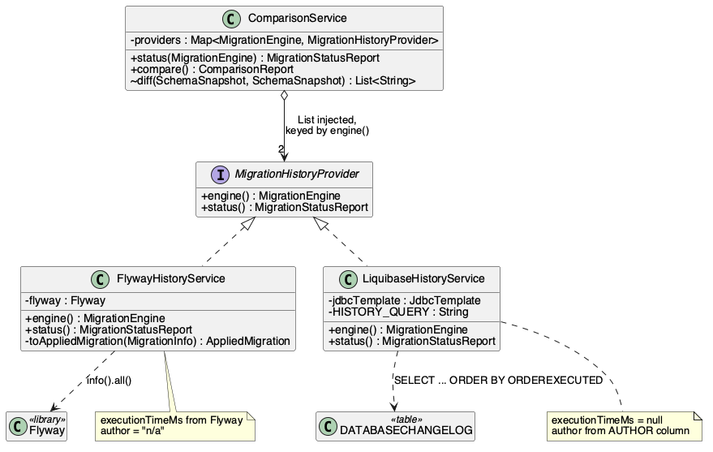

<!-- banner: none yet, author to supply -->

# Two migration engines, one verified schema: a Flyway and Liquibase diff in Java 25 and Spring Boot 4.1

**By Wallace Espindola, Solution Architect**
[LinkedIn](https://www.linkedin.com/in/wallaceespindola/) | [GitHub](https://github.com/wallaceespindola/)

---

## Abstract

This article walks through a Spring Boot 4.1 application on Java 25 that builds the same schema twice, with Flyway 12.4.0 and with Liquibase 5.0.4, each against its own H2 database, and diffs the results at runtime by reading `INFORMATION_SCHEMA`. It covers the explicit bootstrap of both engines with two `DataSource` chains, the `@Qualifier`, `@Primary` and `@DependsOn` annotations that keep them apart and ordered, a history interface with two implementations that share no code, the diff logic, the integration test that fails the build when the schemas drift, and what changed in the move to Spring Boot 4. It is for anyone who wires more than one persistence stack into a Spring context.

---

## The situation

Plenty of Java teams run Flyway in one service and Liquibase in another. Standardizing then becomes a debate over documentation, since few people have seen both engines build the same schema in one codebase. The [flyway-vs-liquibase-db-migrations](https://github.com/wallaceespindola/flyway-vs-liquibase-db-migrations) repository does that. Six Flyway migrations (`V1` to `V5` plus a repeatable `R__` view) and seven Liquibase changesets (`001` to `006`, with `005` split into `005` and `005b`) produce the same three tables, one view and five seeded products. `GET /api/v1/comparison` returns `"schemasEquivalent": true` with zero structural differences, and a test enforces it. This article is about the Java that makes that claim checkable.

## Two databases on purpose

Each engine owns one database and never touches the other: Flyway writes to `./data/flywaydb`, Liquibase to `./data/liquibasedb`. If both ran against one database, the second engine would find the tables already there and the comparison would mean nothing.

That rules out Spring Boot's auto-configuration, which assumes one `DataSource`. The application excludes it in `application.yml`:

```yaml
spring:
  autoconfigure:
    exclude:
      - org.springframework.boot.jdbc.autoconfigure.DataSourceAutoConfiguration
```

The connection settings live under a custom `app.datasource` prefix, so nothing in `spring.*` picks them up by accident. Wiring only one engine by hand would have compared framework code with mine. The point is to show what each tool needs when you do it yourself. Figure 1 shows the result: each configuration class builds the same chain of properties, `DataSource`, engine and `JdbcTemplate`.



*Figure 1: Two independent bean chains, joined only in `ComparisonService`.*

## Bootstrapping Flyway

Here is `FlywayConfig`, with the Javadoc and the two `@Value` fields trimmed:

```java
@Slf4j
@Configuration
public class FlywayConfig {

    public static final String DATA_SOURCE = "flywayDataSource";
    public static final String JDBC_TEMPLATE = "flywayJdbcTemplate";

    @Bean
    @Primary
    @ConfigurationProperties("app.datasource.flyway")
    public DataSourceProperties flywayDataSourceProperties() {
        return new DataSourceProperties();
    }

    @Bean(DATA_SOURCE)
    @Primary
    public DataSource flywayDataSource(
            @Qualifier("flywayDataSourceProperties") DataSourceProperties properties) {
        return properties.initializeDataSourceBuilder().build();
    }

    @Bean(name = "flyway", initMethod = "migrate")
    public Flyway flyway(@Qualifier(DATA_SOURCE) DataSource dataSource) {
        log.info("Configuring Flyway with locations={} baselineOnMigrate={}", locations, baselineOnMigrate);
        return Flyway.configure()
                .dataSource(dataSource)
                .locations(locations)
                .baselineOnMigrate(baselineOnMigrate)
                .validateOnMigrate(true)
                .cleanDisabled(true)
                .load();
    }

    @Bean(JDBC_TEMPLATE)
    @Primary
    @DependsOn("flyway")
    public JdbcTemplate flywayJdbcTemplate(@Qualifier(DATA_SOURCE) DataSource dataSource) {
        return new JdbcTemplate(dataSource);
    }
}
```

`DataSourceProperties` is reused even though its auto-configuration is excluded. Bound to `app.datasource.flyway`, it handles URL, driver and credentials, and `initializeDataSourceBuilder()` picks the pool on the classpath. The [Spring Boot data access how-to](https://docs.spring.io/spring-boot/how-to/data-access.html) shows the same pattern.

The Flyway side is `@Primary`, and something has to be: any bean, yours or a library's, that asks for an unqualified `DataSource` or `JdbcTemplate` would otherwise fail startup with a `NoUniqueBeanDefinitionException`.

The engine is a plain bean with `initMethod = "migrate"`, so the schema is current by the time the `flyway` bean is ready. `cleanDisabled(true)` keeps `clean()`, which drops everything in the schema, out of reach. The qualifier names are constants, so a typo cannot silently break an injection point.

## Bootstrapping Liquibase

`LiquibaseConfig` builds the same chain. Its properties and `DataSource` beans mirror Flyway's without `@Primary`, so this listing keeps only the engine and the template:

```java
@Bean("liquibase")
public SpringLiquibase liquibase(@Qualifier(DATA_SOURCE) DataSource dataSource) {
    log.info("Configuring Liquibase with changeLog={} contexts={}", changeLog, contexts);
    SpringLiquibase liquibase = new SpringLiquibase();
    liquibase.setDataSource(dataSource);
    liquibase.setChangeLog(changeLog);
    liquibase.setContexts(contexts);
    liquibase.setDefaultSchema(defaultSchema);
    liquibase.setDropFirst(false);
    liquibase.setShouldRun(true);
    return liquibase;
}

@Bean(JDBC_TEMPLATE)
@DependsOn("liquibase")
public JdbcTemplate liquibaseJdbcTemplate(@Qualifier(DATA_SOURCE) DataSource dataSource) {
    return new JdbcTemplate(dataSource);
}
```

Flyway needs a location. Liquibase needs a master changelog, contexts and a default schema, because it models changes as changesets with metadata rather than as ordered SQL files. The context `demo` is what selects changesets `005` and `005b`, which carry `context="demo"`. Run with another context and they are skipped.

`SpringLiquibase` implements `InitializingBean` and applies the changelog in `afterPropertiesSet()`, so no `initMethod` is needed. Both engines migrate at the same point in the bean lifecycle.

## What @DependsOn protects against

Each `JdbcTemplate` factory method takes only a `DataSource`. To the container, `flywayJdbcTemplate` has no relationship with the `flyway` bean. Without `@DependsOn("flyway")`, Spring may create the template, and every bean that injects it, before `migrate()` has run.

Today that goes unnoticed: no bean queries during its own initialization, and all singletons exist before the first HTTP request. The race appears the day someone adds a `@PostConstruct` check that does. Whether `v_product_catalog` exists at that moment then depends on bean creation order, an implementation detail of the container. On the Liquibase side nothing even references the `liquibase` bean by type.

[`@DependsOn`](https://docs.spring.io/spring-framework/docs/current/javadoc-api/org/springframework/context/annotation/DependsOn.html) makes the assumption a declared edge: the named bean, migration included, is initialized first. Spring Boot's Flyway and Liquibase auto-configuration adds equivalent dependencies for you. Opt out of it and they are your job.

## One interface, two different implementations

The dashboard needs each engine's history in one shape. The interface is small:

```java
public interface MigrationHistoryProvider {

    /** The engine this provider reports on. */
    MigrationEngine engine();

    /** Current migration status, migrations ordered oldest first. */
    MigrationStatusReport status();
}
```

The two implementations share nothing but the return type, because the engines expose their history in different ways. Figure 2 shows the structure.



*Figure 2: The history providers and what each one reads from.*

Flyway's implementation goes through the engine's API. Trimmed from `FlywayHistoryService` (the report constructor call is left out):

```java
MigrationInfo[] all = flyway.info().all();

List<AppliedMigration> applied = Arrays.stream(all)
        .filter(info -> info.getInstalledOn() != null)
        .map(FlywayHistoryService::toAppliedMigration)
        .sorted(Comparator.comparing(AppliedMigration::appliedAt))
        .toList();

int pending = (int) Arrays.stream(all).filter(info -> info.getInstalledOn() == null).count();

// ...

private static AppliedMigration toAppliedMigration(MigrationInfo info) {
    String identifier = info.getVersion() != null
            ? "V" + info.getVersion()
            : "R__" + info.getDescription();

    return new AppliedMigration(
            identifier,
            info.getDescription(),
            info.getScript(),
            info.getType().name(),
            NO_AUTHOR,
            Objects.toString(info.getChecksum(), null),
            info.getInstalledOn().toInstant(),
            info.getExecutionTime() < 0 ? null : (long) info.getExecutionTime(),
            info.getState().getDisplayName());
}
```

No SQL. `flyway.info().all()` returns applied and pending migrations with state, checksum and execution time, which is why this service injects the `Flyway` bean, not a `JdbcTemplate`. Repeatable migrations have no version, so the identifier comes from the description. `NO_AUTHOR` is `"n/a"`, because Flyway does not record who wrote a migration.

Liquibase has a status API too (`listUnrunChangeSets()` on the `Liquibase` class), but it needs an instance built from the changelog plus an open connection, and `SpringLiquibase` doesn't hand one out. So this implementation treats the tracking table as the interface. Trimmed from `LiquibaseHistoryService`:

```java
private static final String HISTORY_QUERY =
        """
        SELECT ID, AUTHOR, FILENAME, DATEEXECUTED, ORDEREXECUTED, EXECTYPE,
               MD5SUM, DESCRIPTION, COMMENTS, CONTEXTS, LABELS, DEPLOYMENT_ID
        FROM DATABASECHANGELOG
        ORDER BY ORDEREXECUTED
        """;

// ...

public LiquibaseHistoryService(
        @Qualifier(LiquibaseConfig.JDBC_TEMPLATE) JdbcTemplate jdbcTemplate) {
    this.jdbcTemplate = jdbcTemplate;
}

// ...

private static final RowMapper<AppliedMigration> CHANGELOG_ROW_MAPPER =
        (ResultSet rs, int rowNum) -> {
            Timestamp executedAt = rs.getTimestamp("DATEEXECUTED");
            return new AppliedMigration(
                    "%s::%s".formatted(rs.getString("ID"), rs.getString("AUTHOR")),
                    describe(rs),
                    rs.getString("FILENAME"),
                    rs.getString("EXECTYPE"),
                    rs.getString("AUTHOR"),
                    rs.getString("MD5SUM"),
                    executedAt == null ? null : executedAt.toInstant(),
                    null, // Liquibase does not record per-changeset execution time
                    rs.getString("EXECTYPE"));
        };
```

Look at the qualifier on the constructor. Inject the unqualified template and you get the `@Primary` one, which points at the Flyway database, where `DATABASECHANGELOG` does not exist. The `status()` method (not shown) reports zero pending changesets, because `SpringLiquibase` has applied everything by then.

The execution time is `null` by design, and Jackson keeps the field in the JSON. The [`DATABASECHANGELOG` table](https://docs.liquibase.com/secure/user-guide-5-1/what-is-the-databasechangelog-table) holds an author per changeset, contexts, labels and a deployment ID, but no duration. Flyway records a duration and no author.

`ComparisonService` receives both as a `List<MigrationHistoryProvider>` and keys them by `engine()` into an `EnumMap`, so a third engine would be one more `@Service`.

## Reading back what the engines built

Neither the scripts nor the history tables prove what is in the database, so `SchemaInspectionService` asks the database. Trimmed to the column query and the core of `snapshot()`:

```java
private static final String COLUMNS_QUERY =
        """
        SELECT TABLE_NAME, COLUMN_NAME, DATA_TYPE FROM INFORMATION_SCHEMA.COLUMNS
        WHERE TABLE_SCHEMA = ?
        ORDER BY TABLE_NAME, COLUMN_NAME
        """;

public SchemaSnapshot snapshot(MigrationEngine engine) {
    JdbcTemplate jdbc = templateFor(engine);

    List<String> allTables = jdbc.queryForList(TABLES_QUERY, String.class, SCHEMA);
    List<String> businessTables = allTables.stream().filter(t -> !isBookkeeping(t)).toList();
    List<String> bookkeeping = allTables.stream().filter(SchemaInspectionService::isBookkeeping).toList();

    List<String> views = jdbc.queryForList(VIEWS_QUERY, String.class, SCHEMA);

    List<String> columns = jdbc.query(
                    COLUMNS_QUERY,
                    (rs, rowNum) -> "%s.%s:%s".formatted(
                            rs.getString("TABLE_NAME"), rs.getString("COLUMN_NAME"), rs.getString("DATA_TYPE")),
                    SCHEMA)
            .stream()
            .filter(entry -> !isBookkeeping(entry.substring(0, entry.indexOf('.'))))
            .toList();

    // indexes: same shape, omitted here
    return new SchemaSnapshot(engine, businessTables, views, columns, indexes, bookkeeping);
}
```

The service holds both qualified templates in a `Map<MigrationEngine, JdbcTemplate>`, so one method inspects either database through the standard [`INFORMATION_SCHEMA` views](https://h2database.com/html/systemtables.html). Each column becomes a string such as `PRODUCT.ACTIVE:BOOLEAN`. Because the type is part of the string, a column typed differently on each side shows up as a difference. `isBookkeeping` uppercases before comparing because Flyway creates its history table as lowercase `flyway_schema_history` in H2, while the Liquibase tables are uppercase.

## The diff, and why it ignores indexes

The comparison is the shortest listing here, from `ComparisonService`:

```java
static List<String> diff(SchemaSnapshot flyway, SchemaSnapshot liquibase) {
    List<String> differences = new ArrayList<>();
    compareSets("table", flyway.tables(), liquibase.tables(), differences);
    compareSets("view", flyway.views(), liquibase.views(), differences);
    compareSets("column", flyway.columns(), liquibase.columns(), differences);
    return List.copyOf(differences);
}

private static void compareSets(
        String kind, List<String> flywayItems, List<String> liquibaseItems, List<String> sink) {
    new TreeSet<>(flywayItems).stream()
            .filter(item -> !liquibaseItems.contains(item))
            .forEach(item -> sink.add("%s '%s' exists in the Flyway schema but not in the Liquibase schema"
                    .formatted(kind, item)));

    new TreeSet<>(liquibaseItems).stream()
            .filter(item -> !flywayItems.contains(item))
            .forEach(item -> sink.add("%s '%s' exists in the Liquibase schema but not in the Flyway schema"
                    .formatted(kind, item)));
}
```

It compares in both directions, sorts through `TreeSet` for stable messages and returns an immutable list, and `compare()` sets `schemasEquivalent` to `differences.isEmpty()`. `ComparisonServiceTest` unit-tests the static method with hand-built snapshots.

Indexes are collected and shown on the dashboard, but `diff()` leaves them out. H2 creates an index behind every primary key, unique constraint and foreign key, under names it generates, and those names come out differently in the two databases even where the structure is identical. The scripts don't help either: in `V1` the primary key of `category` is inline and unnamed (`id BIGINT AUTO_INCREMENT PRIMARY KEY`), while changeset `001` names it `pk_category`. Comparing names would report drift on every run, and a check that always fails gets ignored. Comparing index definitions (table, columns, uniqueness) would be the right next step. It isn't in the repository yet, and I count it as the main gap in the check.

## The test that enforces the claim

`ApplicationIntegrationTest` boots the full context with `@SpringBootTest`, `@AutoConfigureMockMvc` and `@ActiveProfiles("test")`. The test profile replaces only the two JDBC URLs. Here is `application-test.yml`, without its comments and logging section:

```yaml
app:
  datasource:
    flyway:
      url: jdbc:h2:mem:flyway-test;DB_CLOSE_DELAY=-1;NON_KEYWORDS=VALUE
    liquibase:
      url: jdbc:h2:mem:liquibase-test;DB_CLOSE_DELAY=-1;NON_KEYWORDS=VALUE
```

Tests never touch `./data`, and both engines migrate from scratch on every build. `DB_CLOSE_DELAY=-1` keeps each in-memory database alive for the JVM's lifetime. It is a profile file on purpose: a `src/test/resources/application.yml` would shadow the main configuration instead of merging with it, and the `app.migration.*` keys would disappear.

The nested class that carries the claim, with two of its four tests trimmed:

```java
@Nested
@DisplayName("the central claim")
class CentralClaim {

    @Test
    @DisplayName("both engines produce an equivalent business schema")
    void bothEnginesProduceEquivalentSchema() {
        ComparisonReport report = comparisonService.compare();

        assertThat(report.schemaDifferences())
                .as("Flyway and Liquibase should converge on the same business schema")
                .isEmpty();
        assertThat(report.schemasEquivalent()).isTrue();
    }

    @Test
    @DisplayName("both engines created the same tables and views")
    void bothEnginesCreatedTheSameObjects() {
        var flyway = schemaInspectionService.snapshot(MigrationEngine.FLYWAY);
        var liquibase = schemaInspectionService.snapshot(MigrationEngine.LIQUIBASE);

        assertThat(flyway.tables()).containsExactlyInAnyOrder("CATEGORY", "PRODUCT", "PRODUCT_AUDIT");
        assertThat(liquibase.tables()).containsExactlyInAnyOrderElementsOf(flyway.tables());
        assertThat(flyway.views()).containsExactly("V_PRODUCT_CATALOG");
        assertThat(liquibase.views()).containsExactlyInAnyOrderElementsOf(flyway.views());
        assertThat(liquibase.columns()).containsExactlyInAnyOrderElementsOf(flyway.columns());
    }
}
```

The first test checks the report the endpoint serves. The second pins the expected objects by name, so two empty schemas cannot pass as equivalent. The trimmed tests check that only bookkeeping tables differ and that both catalogs return the same five products. Sibling classes pin the history: 6 Flyway migrations with execution times, 7 Liquibase changesets with authors.

So adding a migration to one engine without its counterpart makes `mvn verify` fail with a message like `column 'PRODUCT.ACTIVE:BOOLEAN' exists in the Flyway schema but not in the Liquibase schema`. Of the project's 86 tests (98.8% line coverage, 80% JaCoCo gate), this class is the one I'd keep if I could keep only one.

## Moving to Spring Boot 4.1 and Jackson 3

The project started on Spring Boot 3.4 and Java 21 and moved when the build failed on a Java 25 JDK: Boot 3.4's Byte Buddy could not instrument Java 25 classes, so every Mockito-based test errored. The BOM of Spring Boot 4.1.2 brought Flyway 12.4.0, Liquibase 5.0.4 and H2 2.4.240. The changes were small and are all in the [Spring Boot 4.0 migration guide](https://github.com/spring-projects/spring-boot/wiki/Spring-Boot-4.0-Migration-Guide):

- **Module packages:** auto-configuration is split into per-technology modules. `DataSourceProperties` and `DataSourceAutoConfiguration` moved from `org.springframework.boot.autoconfigure.jdbc` to `org.springframework.boot.jdbc.autoconfigure`, touching both config classes and the exclusion.
- **Starters:** `spring-boot-starter-web` became `spring-boot-starter-webmvc`, the H2 console needs `spring-boot-h2console`, and `@AutoConfigureMockMvc` moved to `org.springframework.boot.webmvc.test.autoconfigure` in `spring-boot-starter-webmvc-test`.
- **Jackson 3:** `java.time` values are ISO-8601 strings by default, so `serialization.write-dates-as-timestamps: false` went away. `default-property-inclusion: always` replaced it, stating that nulls such as `executionTimeMs` stay in the output.

The engine versions stay unpinned, so the BOM picks both and the comparison stays fair. Flyway 12.4.0 logs a warning that H2 2.4.240 is newer than the H2 it was verified against (2.3.232). Everything works, and I'd rather keep the warning than pin H2.

Two licensing points belong in any decision based on this. Liquibase 5.0 moved Community from Apache 2.0 to the [Functional Source License (FSL-1.1-ALv2)](https://www.liquibase.com/blog/liquibase-community-for-the-future-fsl), which converts to Apache 2.0 after two years. Liquibase calls it source available, not OSI open source. Flyway undo migrations require one of the paid editions, per the [Flyway feature summary](https://documentation.red-gate.com/fd/feature-summary-165740620.html).

## Where the approach stops

The comparison runs on H2. A Liquibase change tag can render differently on PostgreSQL or Oracle, so equivalence on H2 says nothing about other databases. Testcontainers with the production database is the next step for anyone adopting this. The diff covers tables, views and typed columns, not constraints, defaults, nullability or index definitions. That catches a missing counterpart migration, which is the failure the project is about. Hand wiring also costs you the `spring.flyway.*` and `spring.liquibase.*` properties and the automatic ordering. For one database and one engine, I would not do it.

## Summary

Two engines and two databases coexist in one Spring context when every injection point is qualified, one side is `@Primary` and each consumer of a migrated database depends on the bean that migrates it. The history providers show the embedding difference: Flyway gives you `info()`, Liquibase gives you a table. The diff reads `INFORMATION_SCHEMA` instead of trusting scripts, skips indexes for a stated reason, and an integration test turns "both engines build the same schema" into a build failure when it stops being true.

If you run both engines today, which part of your schema would you trust a diff like this to check, and which would you still review by hand?

## References

- flyway-vs-liquibase-db-migrations (source, migrations, tests, diagrams), [GitHub](https://github.com/wallaceespindola/flyway-vs-liquibase-db-migrations)
- Flyway feature summary by edition, [documentation.red-gate.com](https://documentation.red-gate.com/fd/feature-summary-165740620.html)
- Liquibase DATABASECHANGELOG table, [docs.liquibase.com](https://docs.liquibase.com/secure/user-guide-5-1/what-is-the-databasechangelog-table)
- Liquibase 5.0 release notes, [docs.liquibase.com](https://docs.liquibase.com/community/release-notes/5-0)
- Liquibase Community and the Functional Source License, [liquibase.com](https://www.liquibase.com/blog/liquibase-community-for-the-future-fsl)
- Spring Framework `@DependsOn` Javadoc, [docs.spring.io](https://docs.spring.io/spring-framework/docs/current/javadoc-api/org/springframework/context/annotation/DependsOn.html)
- Spring Boot how-to: data access, [docs.spring.io](https://docs.spring.io/spring-boot/how-to/data-access.html)
- Spring Boot 4.0 migration guide, [GitHub](https://github.com/spring-projects/spring-boot/wiki/Spring-Boot-4.0-Migration-Guide)
- H2 system tables and INFORMATION_SCHEMA, [h2database.com](https://h2database.com/html/systemtables.html)

---

## Author bio

Wallace Espindola is a software engineer and solution architect working with Java/Spring Boot, Python/FastAPI and cloud-native microservices on Kubernetes and OpenShift. He designs backend systems, from architecture decisions and database design to test strategy. Reach him on [LinkedIn](https://www.linkedin.com/in/wallaceespindola/) or see his projects on [GitHub](https://github.com/wallaceespindola/).

---

**Examples repository:** the Spring Boot application, both sets of migrations, the integration tests and the diagrams from this article are in <https://github.com/wallaceespindola/flyway-vs-liquibase-db-migrations>.

Need more tech insights?
Check out my GitHub, LinkedIn, and Speaker Deck.
Happy coding!

Wallace Espindola, Solution Architect

- GitHub: <https://github.com/wallaceespindola/>
- LinkedIn: <https://www.linkedin.com/in/wallaceespindola/>
- Speaker Deck: <https://speakerdeck.com/wallacese>
