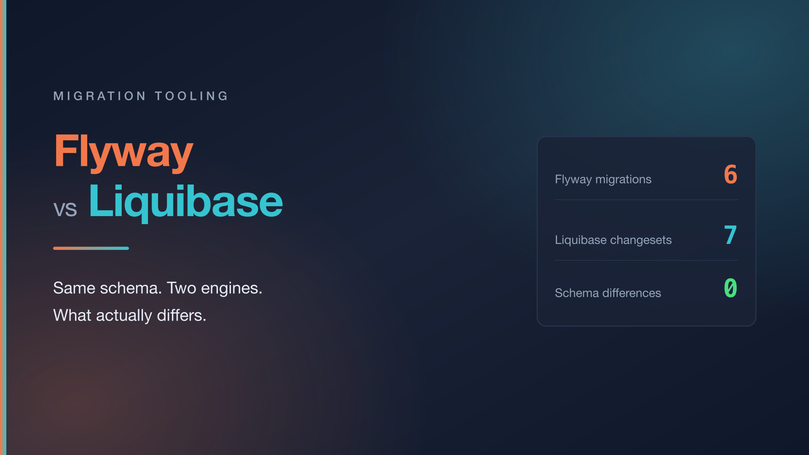
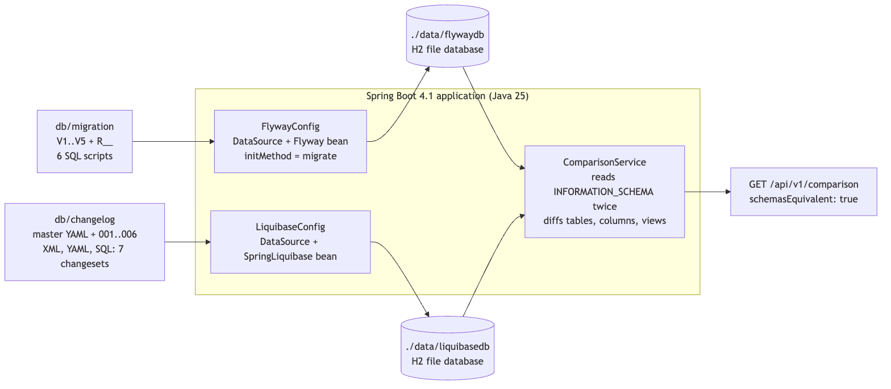

# Your migration tool is a governance decision



Most teams pick a database migration tool once, early, and then live with it for the life of the service. The choice usually comes down to whoever set up the first project, or a comparison slide that says Flyway is simpler and Liquibase is more powerful. Neither is a decision a tech lead would sign off on for anything else that lasts that long.

I wanted a better basis, so I built a small Spring Boot 4.1.2 application on Java 25 that creates the same schema twice: once with Flyway, once with Liquibase, each in its own H2 database. An endpoint then reads both schemas back and reports whether they match. The code is on GitHub: [flyway-vs-liquibase-db-migrations](https://github.com/wallaceespindola/flyway-vs-liquibase-db-migrations). This article isn't about the code. It's about the decisions a lead makes when choosing between the two, and what the experiment says about each one.

## Correctness is not the decision

The first result settles the question people tend to argue about. `GET /api/v1/comparison` returns `schemasEquivalent: true` with zero structural differences in tables, columns and views. Two tools that never talk to each other built the same database.



So you can take "which tool gets the schema right" off the table. Both do. What's left are choices about how your team works, what you need to audit and what licenses you accept. Those are lead decisions, and they deserve to be written down.

## Decision 1: your rollback policy

This is the one with the biggest operational effect. Flyway Community has no undo. To revert a change you write a new forward migration. Undo migrations exist only in Flyway's [paid editions](https://documentation.red-gate.com/fd/feature-summary-165740620.html). Liquibase includes rollback for free: most changes get it automatically, and the rest declare it in a `rollback` block, so `liquibase rollbackCount 1` is a command you can rehearse in staging.

So the lead's first question is "what is our rollback policy", and the tool follows from the answer:

- **Forward-only by design:** many teams use expand and contract and never roll schema changes back in production. Flyway Community fits this well, and its lack of undo costs little.
- **Rollback as a tested runbook step:** if your release process or your auditors expect a rehearsed "put it back" command, Liquibase gives it to you without buying anything.

If you can't answer this question today, that's worth fixing before choosing a tool.

## Decision 2: what you need to audit

The two tools keep very different history tables, and the experiment made the gap visible. Flyway records version, description, checksum and execution time in `flyway_schema_history`. Liquibase's `DATABASECHANGELOG` records author, contexts, labels, deployment ID and execution type, but no duration at all. The app's API returns `"executionTimeMs": null` for every Liquibase row and `"author": "n/a"` for every Flyway row, because those values don't exist.

So ask what your audit and incident reviews need:

- **"Who wrote this change, and for which environment?"** Liquibase keeps the answer in the database. With Flyway it lives in version control.
- **"How long did each migration take?"** Flyway records it. Liquibase doesn't.

There's also a practical twist for teams that build internal dashboards. Flyway's `flyway.info()` is available straight from the bean the app already has. Liquibase has a status API too, but it lives on the `Liquibase` class and needs an instance built from the changelog plus an open connection. The Spring integration runs the update and doesn't hand you that object, so the app reads its history with a plain `SELECT` against `DATABASECHANGELOG`. It's a small thing, but know it before someone promises a status page.

## Decision 3: how much control per change you want

Liquibase lets each change carry its own conditions. In the project, Flyway's `V5` adds a column and backfills it in one script. Liquibase splits the same change into two changesets, `005` labeled `schema-evolution` and `005b` labeled `data-backfill`, which is why Flyway reports 6 applied migrations and Liquibase reports 7. Here's the backfill changeset, trimmed from the repo (its rollback block is left out):

```xml
<changeSet id="005b-backfill-product-active-flag" author="wallaceespindola" context="demo"
           labels="data-backfill">
    <update tableName="product">
        <column name="active" valueBoolean="false"/>
        <where>stock_quantity = 0</where>
    </update>
</changeSet>
```

With that split, a pipeline can ship the column everywhere and hold the backfill for a maintenance window. Preconditions add another layer: a changeset can check that a table exists and skip itself instead of failing the deploy.

That control has a cost. Reviewers have to learn the changeset model and the tag vocabulary, while a Flyway migration is plain SQL that any reviewer can read. Ask whether your team will use per-change control often enough to pay for it.

## Decision 4: the license you accept

This one is new, and I think it's the decision most teams haven't made consciously yet.

With version 5.0, [announced on September 30, 2025](https://www.liquibase.com/blog/liquibase-community-for-the-future-fsl), Liquibase moved its Community edition from Apache 2.0 to the Functional Source License (FSL-1.1-ALv2). Each release converts to Apache 2.0 after two years. Liquibase's own FAQ calls it "source available", not OSI open source. Contributors now sign a CLA, and the [5.0 release notes](https://docs.liquibase.com/community/release-notes/5-0) list the paid edition, previously Pro, under its new name, Liquibase Secure.

This matters for a lead because it can change silently. Spring Boot 4.1's dependency management brings in Liquibase 5.0.4, so a routine framework upgrade moves you onto the FSL. For most teams using Liquibase inside their own services, I don't expect a practical problem. But some organizations allow only OSI-approved licenses, and some have open source program offices that want to see every license change. Someone on the team should make that call before the upgrade lands.

What I'd put in front of the team:

- **Check the policy:** does your organization accept source-available licenses for build and runtime dependencies?
- **Record the decision:** a short architecture decision record saying which Liquibase version line you use and why.
- **Compare like with like:** Flyway's undo, dry runs and drift detection are in paid editions. Liquibase's rollback and diff are free under the FSL. "Free" means a different set of features on each side.

## Decision 5: who owns the merge risk

Flyway discovers migrations by file name, so two branches that pick the same version number fail validation loudly. Liquibase uses a master changelog that lists every file. Two branches appending to it produce a Git conflict, and a careless resolution can drop an include without failing anything until someone notices a changeset never ran. That won't decide the tool on its own. If you go with Liquibase, name an owner for migration ordering and add a review rule for the master changelog.

## Where this doesn't pay off

If a service changes its schema a few times a year, none of this is worth a long debate. Pick the tool your team already knows. The decisions above matter for long-lived services with many contributors, regulated environments and platforms that ship to more than one database engine.

## Summary

Flyway and Liquibase build the same schema. What you're choosing is a set of governance decisions: your rollback policy, what you need to audit, how much per-change control you want, which licenses you accept and who owns merge risk. Make those calls first, write them down, and the tool choice mostly follows. The repository includes an 18-row feature matrix served by the app, which is a useful starting point for that conversation with your team.

Has the Liquibase license change come up in your dependency reviews yet, and did it change anything? Let me know your thoughts in the comments.

**#database #flyway #liquibase #springboot #techleadership #softwarearchitecture**

---

**Examples repository:** the Spring Boot application that builds one schema with both Flyway and Liquibase, the comparison endpoint, the feature matrix and the diagrams are in <https://github.com/wallaceespindola/flyway-vs-liquibase-db-migrations>.

Need more tech insights?
Check out my GitHub, LinkedIn, and Speaker Deck.
Happy coding!

Wallace Espindola, Solution Architect

- GitHub: <https://github.com/wallaceespindola/>
- LinkedIn: <https://www.linkedin.com/in/wallaceespindola/>
- Speaker Deck: <https://speakerdeck.com/wallacese>
