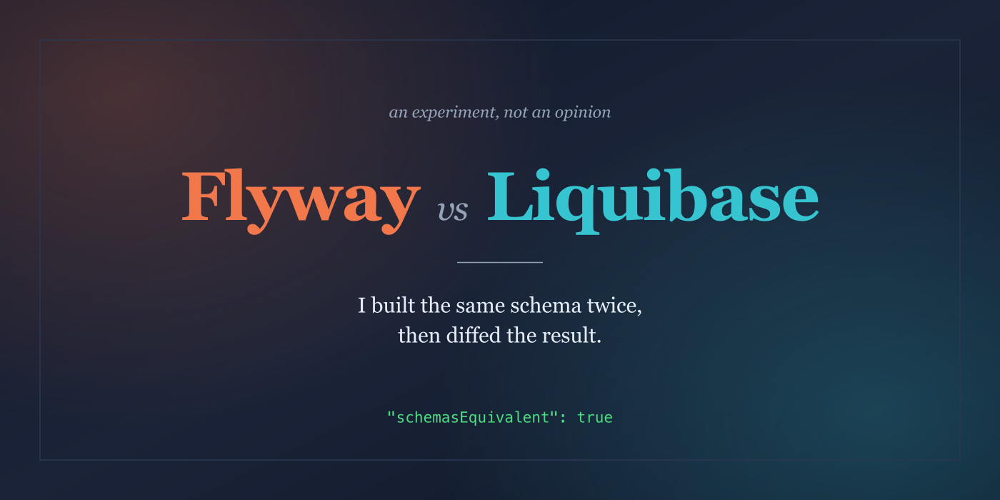
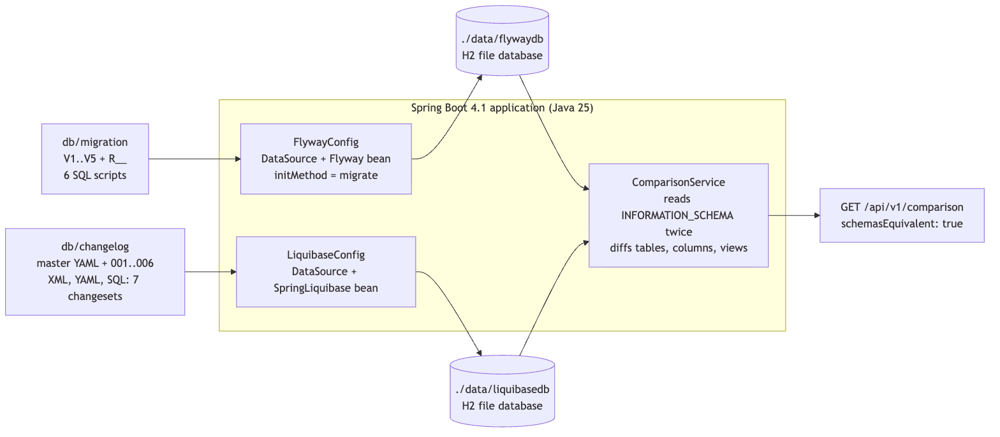
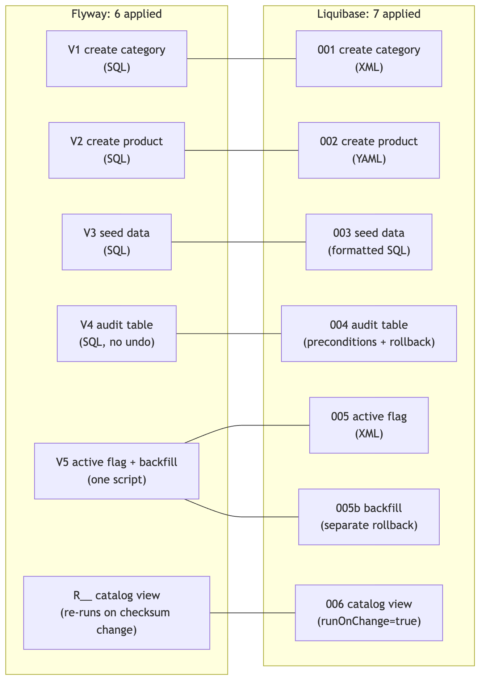

<!--
Medium metadata
Tags: Database, Java, Spring Boot, Software Architecture, DevOps
Meta description: Flyway and Liquibase built the same schema in one Spring Boot app, with zero differences. What really separates them is rollback, bookkeeping and licensing.
-->

# Flyway or Liquibase? The difference was never the schema

*I built one schema twice, with Flyway and with Liquibase, and diffed the result. The schemas matched, so the real differences sit around them*



*By [Wallace Espindola](https://www.linkedin.com/in/wallaceespindola/), Solution Architect | [GitHub](https://github.com/wallaceespindola/)*

---

Open the resources folder of a small Spring Boot application and you'll find two migration trees side by side. One is `db/migration`, six SQL files with names like `V1__create_category_table.sql`. The other is `db/changelog`, a master YAML file that includes six more files written in XML, YAML and SQL. They describe the same four business objects: a `category` table, a `product` table, a `product_audit` table and a `v_product_catalog` view.

The Flyway versus Liquibase question usually gets settled by opinion. Flyway is simpler. Liquibase is more powerful. Flyway is plain SQL, so it's safer. Liquibase has rollback, so it's safer. All of these are partly true, and I rarely see anyone check them against running code. So I wrote the application above to make the comparison executable: each engine builds the schema in its own database, and an endpoint reads both back and reports whether they match.

The code is in [flyway-vs-liquibase-db-migrations](https://github.com/wallaceespindola/flyway-vs-liquibase-db-migrations), on Java 25 and Spring Boot 4.1.2. This essay isn't a tutorial. It's about what the experiment told me, and mostly that the usual question is the wrong one.

## Two engines, two databases, one schema

The setup is the part that makes the result mean anything. Flyway owns `./data/flywaydb` and Liquibase owns `./data/liquibasedb`, both H2 file databases. Neither engine ever touches the other's database. If you put them in one database, you're comparing nothing.



I also refused Spring Boot's auto-configuration for both. `DataSourceAutoConfiguration` is excluded, and `FlywayConfig` and `LiquibaseConfig` each build their own `DataSource`, engine and `JdbcTemplate` by hand. Auto-configuration is what you want in a real service, but here it would hide the thing I wanted to see: what each tool needs before it can run. Trimmed from the two config classes, the engine beans look like this:

```java
@Bean(name = "flyway", initMethod = "migrate")
public Flyway flyway(@Qualifier(DATA_SOURCE) DataSource dataSource) {
    return Flyway.configure()
            .dataSource(dataSource)
            .locations(locations)
            .baselineOnMigrate(baselineOnMigrate)
            .validateOnMigrate(true)
            .cleanDisabled(true)
            .load();
}

@Bean("liquibase")
public SpringLiquibase liquibase(@Qualifier(DATA_SOURCE) DataSource dataSource) {
    SpringLiquibase liquibase = new SpringLiquibase();
    liquibase.setDataSource(dataSource);
    liquibase.setChangeLog(changeLog);
    liquibase.setContexts(contexts);
    liquibase.setDefaultSchema(defaultSchema);
    liquibase.setDropFirst(false);
    liquibase.setShouldRun(true);
    return liquibase;
}
```

Flyway takes a data source and a location. Liquibase takes a data source, a changelog entry point, contexts and a default schema. That difference in knobs is a small preview of the whole comparison. Both migrate during bean initialization, and each side's `JdbcTemplate` carries a `@DependsOn` on its engine bean so nothing queries a database before it has been migrated.

Engine versions come straight from the Spring Boot BOM, not pinned by me: Flyway 12.4.0, Liquibase 5.0.4 and H2 2.4.240. Letting the BOM pick keeps the comparison fair. (Flyway logs a warning that H2 2.4.240 is newer than the H2 version it was verified against. Everything works anyway.)

## The schema question has a boring answer

`GET /api/v1/comparison` reads `INFORMATION_SCHEMA` in both databases and diffs tables, columns and views. Trimmed to the fields that matter, the response is:

```json
{
  "success": true,
  "message": "Both engines produced an equivalent business schema",
  "data": {
    "flyway":    { "engine": "FLYWAY",    "appliedCount": 6, "pendingCount": 0, "upToDate": true },
    "liquibase": { "engine": "LIQUIBASE", "appliedCount": 7, "pendingCount": 0, "upToDate": true },
    "schemasEquivalent": true,
    "schemaDifferences": []
  }
}
```

There are zero structural differences. The comparison ignores indexes on purpose, because H2 names the indexes behind constraints differently depending on who created them, and comparing those names would report noise as drift. Everything a developer would actually query is identical.

So if your evaluation question is "which tool builds the correct database", you can stop there. Either one does. I suspect most of us knew that already, and the debate keeps going because the differences that matter sit around the schema: how changes are found, how they are undone, what gets recorded and what you can read back from inside your own application.

The one number that differs, 6 against 7, is a good place to start looking.

## Six against seven is a modeling choice

Flyway's `V5` adds an `active` column to `product` and backfills it in the same script. Liquibase's `005` file splits that into two changesets, one for the column and one for the backfill, each with its own label and its own rollback. Trimmed from `005-add-product-active-flag.xml` (comments, the index and the first changeset's rollback left out):

```xml
<changeSet id="005-add-product-active-flag" author="wallaceespindola" context="demo"
           labels="schema-evolution">
    <addColumn tableName="product">
        <column name="active" type="BOOLEAN" defaultValueBoolean="true">
            <constraints nullable="false"/>
        </column>
    </addColumn>
</changeSet>

<changeSet id="005b-backfill-product-active-flag" author="wallaceespindola" context="demo"
           labels="data-backfill">
    <update tableName="product">
        <column name="active" valueBoolean="false"/>
        <where>stock_quantity = 0</where>
    </update>

    <rollback>
        <update tableName="product">
            <column name="active" valueBoolean="true"/>
            <where>stock_quantity = 0</where>
        </update>
    </rollback>
</changeSet>
```

Nothing went wrong to produce the extra row in the history table. The two tools invite different granularity. In Flyway the natural unit is a script, and a script is whatever you put in it. In Liquibase the natural unit is a changeset, and because each one can carry its own labels, contexts and rollback, there's a reason to keep them small. A pipeline can ship the column everywhere and hold the backfill for a maintenance window, filtering on `labels`.



Every Flyway file in the project has a deliberate Liquibase counterpart, and the test suite asserts both counts. If someone adds a migration to one side and forgets the other, the equivalence check fails the build. I like that the comparison polices itself.

## Discovery: a naming rule or a manifest

Flyway finds migrations by scanning a location and ordering files by the version in their names. There's no list to maintain. Liquibase needs an explicit entry point that includes every file in order. Trimmed from `db.changelog-master.yaml`:

```yaml
databaseChangeLog:
  - include:
      file: db/changelog/changes/001-create-category-table.xml
  - include:
      file: db/changelog/changes/002-create-product-table.yaml
  - include:
      file: db/changelog/changes/003-seed-reference-data.sql
```

That reads like a mechanical detail until two branches each add a migration. On the Flyway side, if both pick the next version number, validation fails loudly and someone renames a file. On the Liquibase side, both branches append a line at the same spot in the include list, which produces a Git conflict. The risk is a careless resolution that drops an include. Nothing fails until someone notices a changeset never ran. I'd rather have the loud one, but I also know a review rule ("changes to the master changelog get a second look") closes most of the gap.

## Format: plain SQL or a vocabulary of tags

Flyway Community migrations are mostly SQL in your database's dialect. Anyone who can read SQL can review them, and that matters more than it sounds. A reviewer who has never used either tool can read `ALTER TABLE product ADD COLUMN active ...` and tell you if it's wrong.

Liquibase accepts XML, YAML, JSON and SQL as first-class formats, and the project mixes three of them in one changelog: `001` is XML, `002` is YAML and `003` is a SQL-formatted changelog. The abstraction buys dialect portability, since Liquibase generates the DDL for the target database at runtime. It also has an edge. `002` needs check constraints such as `price >= 0`, which have no portable tag, so that changeset drops to an inline `sql` block for those lines.

I don't think this one has a winner. If your product runs on one database and always will, portability is a feature you pay for in learning curve and never use. If you ship to customers who bring their own database, it's the reason to pick Liquibase at all.

## Rollback is where the tools really part ways

Rollback decides what a bad deployment day looks like. Flyway's `V4` adds an audit table. Trimmed (the header comment and the seed `INSERT ... SELECT` backfill are left out):

```sql
-- Flyway V4: add an audit trail table.
CREATE TABLE product_audit
(
    id           BIGINT AUTO_INCREMENT PRIMARY KEY,
    product_id   BIGINT       NOT NULL,
    audit_action VARCHAR(20)  NOT NULL,
    changed_by   VARCHAR(100) NOT NULL DEFAULT 'system',
    changed_at   TIMESTAMP    NOT NULL DEFAULT CURRENT_TIMESTAMP,
    CONSTRAINT fk_product_audit_product FOREIGN KEY (product_id) REFERENCES product (id)
);

CREATE INDEX idx_product_audit_product ON product_audit (product_id);
```

There is no rollback here, because Flyway Community has none. Undo migrations exist in Flyway's [paid editions](https://documentation.red-gate.com/fd/feature-summary-165740620.html) (Enterprise can even generate them), but on Community you revert by writing a new forward migration that undoes the old one.

The Liquibase changeset for the same table carries a precondition and a rollback. Trimmed from `004-add-product-audit-table.xml`, with the column definitions, the index and the seed insert left out:

```xml
<changeSet id="004-add-product-audit-table" author="wallaceespindola" context="demo">
    <preConditions onFail="MARK_RAN" onFailMessage="product table missing, skipping audit table">
        <tableExists tableName="product"/>
    </preConditions>

    <comment>Add the product audit trail, guarded by a precondition</comment>

    <createTable tableName="product_audit">
        <!-- columns omitted -->
    </createTable>

    <rollback>
        <dropIndex tableName="product_audit" indexName="idx_product_audit_product"/>
        <dropTable tableName="product_audit"/>
    </rollback>
</changeSet>
```

Two things in there have no declarative Flyway equivalent. The precondition marks the changeset as run when `product` is missing instead of failing the deploy. The rollback block makes `liquibase rollbackCount 1` a command you can run in a test environment before you ever need it in production. (Element order matters here: `preConditions` must come before `comment` and the change tags, or the changelog fails to parse at startup. That one cost me a debug cycle.)

The forward-only school deserves a fair hearing, because it's a deliberate position. Many teams never roll back schema changes in production anyway. They use expand and contract: add the new column, migrate the code, remove the old one later, and treat every change as a step forward. In that model a rollback script is code that never runs until the worst possible moment, which is a fair reason to distrust it. Where I land: if your releases are forward-only by design, Flyway's lack of undo costs you little. If you need "put it back the way it was" as a tested, rehearsed command, Liquibase gives it to you for free and Flyway asks you to pay.

## Reading history from inside the app

The finding I didn't expect only showed up once I tried to report each engine's status from the application itself, instead of from a CLI.

Flyway's read API is one call on the bean the app already has. `flyway.info()` hands back every known migration as an object, applied and pending, with state, checksum and execution time already filled in. Trimmed from `FlywayHistoryService`:

```java
MigrationInfo[] all = flyway.info().all();

List<AppliedMigration> applied = Arrays.stream(all)
        .filter(info -> info.getInstalledOn() != null)
        .map(FlywayHistoryService::toAppliedMigration)
        .sorted(Comparator.comparing(AppliedMigration::appliedAt))
        .toList();
```

Liquibase has a status API too, `getChangeSetStatuses()` and `listUnrunChangeSets()` on the `Liquibase` class, but it needs an instance built from the changelog plus an open database connection. `SpringLiquibase` runs the update at startup and doesn't hand you that object, so `LiquibaseHistoryService` queries the bookkeeping table directly:

```java
private static final String HISTORY_QUERY =
        """
        SELECT ID, AUTHOR, FILENAME, DATEEXECUTED, ORDEREXECUTED, EXECTYPE,
               MD5SUM, DESCRIPTION, COMMENTS, CONTEXTS, LABELS, DEPLOYMENT_ID
        FROM DATABASECHANGELOG
        ORDER BY ORDEREXECUTED
        """;
```

Building a second `Liquibase` instance just to read status felt heavier than one query, so the table became the interface. In exchange, look at what it holds: author, contexts, labels, deployment ID, execution type. Flyway records none of those in `flyway_schema_history`. Who wrote a Flyway migration is a question for `git blame`. Liquibase makes `author` mandatory on every changeset and keeps it in the database.

The trade runs the other way for timing. Flyway stores execution time per migration in milliseconds. `DATABASECHANGELOG` has no duration column, so the Liquibase side returns `"executionTimeMs": null` on every row. I kept those nulls in the JSON on purpose. Hiding them would make the two engines look more alike than they are.

So the bookkeeping models answer different questions. Flyway tells you how long each change took. Liquibase tells you who wrote it, for which environment and under which label. Neither tells you both. Both use checksums to stop someone from editing an applied migration (CRC32 for Flyway, MD5 for Liquibase), so on that one they agree.

## The one place they agree: repeatable objects

Views are the easy case. Both tools have a way to say "redefine this whenever its source changes" instead of versioning it. Flyway uses a filename prefix, `R__product_catalog_view.sql`. Liquibase uses an attribute on an ordinary changeset, `runOnChange="true"` in `006-product-catalog-view.xml`. Both re-run when the checksum changes and stay quiet otherwise.

## The question that changed in 2025: licensing

For years the licensing comparison was simple. Liquibase Community was Apache 2.0 and included rollback and diff. Flyway Community was free and kept undo, dry runs and drift detection for paid editions.

That changed with Liquibase 5.0. In its [announcement of September 30, 2025](https://www.liquibase.com/blog/liquibase-community-for-the-future-fsl), Liquibase moved Community from Apache 2.0 to the Functional Source License (FSL-1.1-ALv2). Each release converts to Apache 2.0 after two years, and Liquibase's own FAQ describes the license as "source available", not OSI open source. Per the [5.0 release notes](https://docs.liquibase.com/community/release-notes/5-0), the commercial product formerly called Pro is now Liquibase Secure. Anyone contributing code also has to sign a CLA.

This project pulls Liquibase 5.0.4 from the Spring Boot 4.1 BOM, so it's on the FSL whether I chose that or not. For using Liquibase inside your own application, I don't think much changes in practice. The FSL is mostly aimed at competing commercial offerings. But "mostly" is a word your legal team will want to read for itself, and some organizations have policies that allow OSI licenses and nothing else. The point I'd make is narrower: Liquibase's free rollback and diff are still free, and Flyway's undo is still paid, but "both are open source" is no longer a sentence you can write without a footnote.

## What I'd actually pick

If your team writes and reviews SQL comfortably, targets one database and treats reverts as new forward migrations, Flyway's simplicity pays off every day. Its `info()` API also makes an embedded status page a few lines of code.

If you need one changelog to run against several database engines, rollback as a tested command, or per-change control through preconditions, contexts and labels, Liquibase's extra ceremony buys capabilities you can point at. Its history table also answers "who changed this" without leaving the database.

Where neither pays off is a service that changes its schema twice a year. For that, pick the one your team already knows and spend the energy elsewhere.

## Wrapping up

The experiment confirmed what I expected about the schema and surprised me about almost everything else. Here is where I ended up:

- Both tools built the same schema, with zero structural differences. Schema correctness is not a reason to pick either one.
- Rollback is where they part ways. Liquibase includes it for free, while Flyway keeps undo in paid editions and expects forward fixes on Community.
- The bookkeeping models record different things: Flyway records time, Liquibase records authorship, contexts and labels.
- Flyway's `info()` comes straight from the Spring bean. Liquibase's status API needs its own instance, so the app queries the table, which is less convenient and more informative.
- Liquibase 5's move to the FSL makes licensing a decision you now have to make on purpose, not a default.

I'm curious how this looks from your side. Does your team rely on rollback scripts, or is everything forward-only by design? Has the Liquibase license change come up in your organization's dependency reviews? And if you moved from one tool to the other, what actually triggered the switch? Let me know in the comments.

---

**Examples repository:** the Spring Boot application with both migration trees, the comparison endpoint, the 18-row feature matrix, the tests and the diagrams is in <https://github.com/wallaceespindola/flyway-vs-liquibase-db-migrations>.

Need more tech insights?
Check out my GitHub, LinkedIn, and Speaker Deck.
Happy coding!

Wallace Espindola, Solution Architect

- GitHub: <https://github.com/wallaceespindola/>
- LinkedIn: <https://www.linkedin.com/in/wallaceespindola/>
- Speaker Deck: <https://speakerdeck.com/wallacese>
