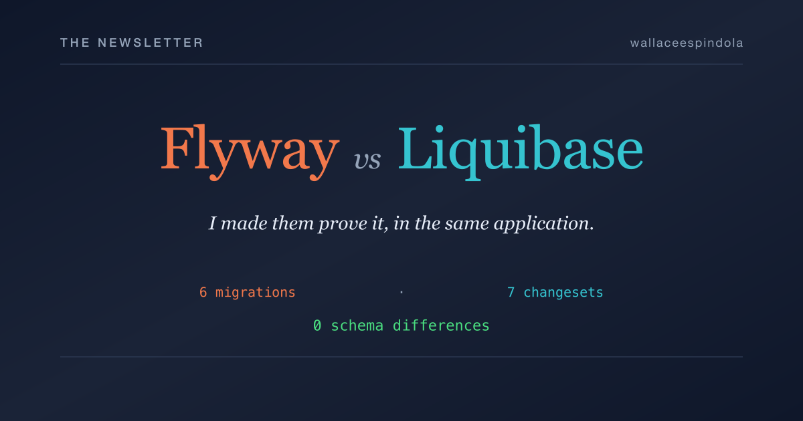
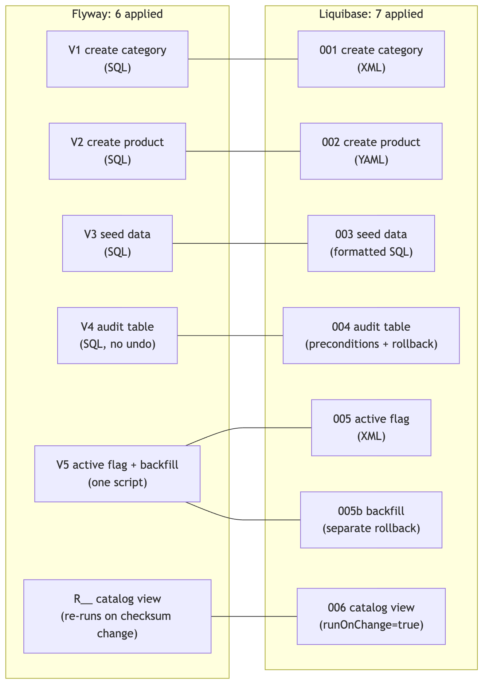

**Suggested subject line:** Flyway or Liquibase? I stopped guessing and ran both

*Preview text: The habit: build the same small thing with both tools and let a test say what differs.*

---



# Make the migration tools prove it before you pick one

Hey folks,

Some tooling history first. I've used Flyway on some projects and Liquibase on others, and if I'm fair to myself, the choice was rarely made on the merits. It was whatever the team already knew, whatever the previous architect had wired up, or whichever one looked quicker to bootstrap that week. Then the trade-offs show up later, usually on the day someone asks how to undo last night's migration.

Most comparisons don't help much with that. They are feature tables, and feature tables are claims. "Liquibase supports rollback." Sure, but what does the file look like, and what do you lose in exchange? "Flyway is simpler" doesn't say what simpler means once it is wired into an application with its own datasource and lifecycle.

So I tried a different habit, and this issue is the coffee-length version of it: the habit, what it turned up when I applied it to Flyway and Liquibase, where it doesn't pay off and what to try on Monday. The code is in a public repo: [flyway-vs-liquibase-db-migrations](https://github.com/wallaceespindola/flyway-vs-liquibase-db-migrations).

## The habit: build it twice, then diff

When two tools claim to do the same job, build one real thing with each of them, side by side, and write a check that compares the results. Keep it small, but give it enough moving parts to hit the awkward cases: a foreign key, seed data, a schema change on a table that already holds rows, a view.

For the migration tools, that became a Spring Boot 4.1.2 app on Java 25 with two H2 databases. Flyway owns one, Liquibase owns the other, and neither ever touches the other's database. Both get the same logical schema, written once in each tool's own style. At startup both migrate, and an endpoint reads the two schemas back from `INFORMATION_SCHEMA` and compares tables, columns and views.



The comparison runs as a test. If I add a migration to one side and forget its twin, the integration test fails. That's the part I'd want any comparison to have: a way to be wrong that someone notices.

## What the check says

Run the app and ask it. The repo has a Makefile target that prints the headline:

```bash
./start.sh
make api
```

And the answer, on a clean start:

```text
schemasEquivalent: True
differences: none
flyway applied: 6
liquibase applied: 7
```

The schema matches and the counts don't, and none of the feature tables I'd read mentioned that.

## Finding one: the granularity is different

Flyway's fifth migration adds an `active` flag to products and backfills it in one script (header comment trimmed):

```sql
ALTER TABLE product
    ADD COLUMN active BOOLEAN NOT NULL DEFAULT TRUE;

UPDATE product
SET active = FALSE
WHERE stock_quantity = 0;

CREATE INDEX idx_product_active ON product (active);
```

On the Liquibase side I wrote the same change as two changesets: `005` adds the column and index, `005b` does the backfill. Each has its own rollback and its own label (`schema-evolution` and `data-backfill`), so a pipeline could apply the schema change everywhere and run the data change separately. Flyway can do the same if you split it into two versioned files yourself. The tool just doesn't nudge you there, and the history table shows the difference as one extra row.

Neither is wrong, but it says something about how each tool expects you to work: Flyway in scripts, Liquibase in changes you might want to reverse one at a time.

## Finding two: the history tables remember different things

Both tools keep a bookkeeping table, and I assumed they'd record roughly the same things. They don't.

Flyway's `flyway_schema_history` records how long each migration took, in milliseconds, and nothing about who wrote it. Ask the app for a Flyway migration and the author comes back as `n/a`. Liquibase's `DATABASECHANGELOG` makes the author a mandatory part of every changeset's identity, and also stores contexts, labels and a deployment id. What it doesn't store is duration. Liquibase prints "ran successfully in 3ms" in the startup log and then doesn't persist it, so the app returns `null` for execution time on every Liquibase row and keeps that null visible in the JSON on purpose.

Reading that history back from inside the app was different too. Flyway hands you an API, `flyway.info()`, that returns applied and pending migrations as objects. Liquibase has a status API too, but it lives on a `Liquibase` instance that `SpringLiquibase` doesn't hand you, so the service just runs a `SELECT` against `DATABASECHANGELOG`. I kept both implementations as they are, because the difference is the finding.

If you care about audit (who changed the schema and as part of which deployment), Liquibase gives you more. If you care about spotting slow migrations from the history, Flyway does. I wouldn't have put either on a shortlist before building this.

## Finding three: rollback, and what it costs now

This is the one most people pick a tool on. The repo's audit table migration shows it plainly: the Flyway `V4` script has no way back, and its comment says that reverting means writing a new forward migration. The Liquibase changeset `004` carries a precondition (skip it if the `product` table is missing) and an explicit `<rollback>` block, so `rollbackCount 1` is something you can actually test.

Flyway does have undo migrations, but not in Community. Redgate's [feature summary](https://documentation.red-gate.com/fd/feature-summary-165740620.html) lists them in the paid editions, and Enterprise can also generate the undo scripts for you.

Then the license changed under the comparison. With [Liquibase 5.0](https://docs.liquibase.com/community/release-notes/5-0), announced on 30 September 2025, Liquibase Community moved from Apache 2.0 to the [Functional Source License](https://www.liquibase.com/blog/liquibase-community-for-the-future-fsl) (FSL-1.1-ALv2), which converts to Apache 2.0 after two years. Liquibase describes it as source available rather than OSI open source, contributors now sign a CLA, and the paid product is now called Liquibase Secure ([it was Pro](https://www.liquibase.com/5-0-launch) before 5.0). So "rollback is free in Liquibase" is still true, with an asterisk your legal team may want to read.

That's the kind of fact a feature table from two years ago gets wrong, and a habit of re-running the comparison catches. The engine versions in the project come from the Spring Boot BOM (Flyway 12.4.0, Liquibase 5.0.4), so bumping Spring Boot re-runs the whole comparison against new versions for free.

## Where it doesn't pay off

Building things twice has a cost, and it isn't always worth it.

- **The choice is already made:** if the platform team picked Flyway three years ago and every service uses it, a side-by-side won't change much. Learn the one you have.
- **The tools aren't really alternatives:** the habit works when two tools do the same job. Comparing a migration tool with a schema-diff tool mostly tells you they're different tools.
- **The sample is too small:** a single `CREATE TABLE` agrees on both sides and proves nothing. You need the awkward cases (a backfill, a view, a constraint the tool can't express portably) or the comparison is theater.
- **No time to keep it honest:** the value is in the check failing when something drifts. If nobody will run it again after the next upgrade, a one-off spike and a written note are cheaper.

For me, this project landed on the right side of that line. It's 86 tests and two sets of migration files, and it answers questions I used to answer from memory.

## Try this on Monday

Pick a decision your team keeps having opinions about. It doesn't have to be migrations: two HTTP clients, two JSON mappers, two ways to run background jobs.

1. Write down the three claims people make about each option.
2. Build the smallest thing that exercises those claims with both, in one repo.
3. Add one check that compares the results and fails when they diverge.
4. Note what surprised you, especially anything no feature table mentioned.

If you want a starting point for the migration case, clone the repo and run `./start.sh --clean`, which wipes both databases and lets you watch every migration run from scratch.

## Wrapping up

Flyway and Liquibase both built the same schema here, so correctness was never the question. What separated them was everything around it: how finely changes are split, what the history remembers, how you read it back, how you undo something, and what the license now says. I only found most of that by building it twice and letting a test compare the result.

My question for you: which tool decision on your team was made from a feature table, and would it survive being built twice? Hit reply or drop a comment. I read every one.

**Examples repository:** the Spring Boot app, the paired Flyway and Liquibase migrations, the comparison endpoint and its tests are all in <https://github.com/wallaceespindola/flyway-vs-liquibase-db-migrations>.

Need more tech insights?
Check out my GitHub, LinkedIn, and Speaker Deck.
Happy coding!

Wallace Espindola, Solution Architect

- GitHub: <https://github.com/wallaceespindola/>
- LinkedIn: <https://www.linkedin.com/in/wallaceespindola/>
- Speaker Deck: <https://speakerdeck.com/wallacese>
