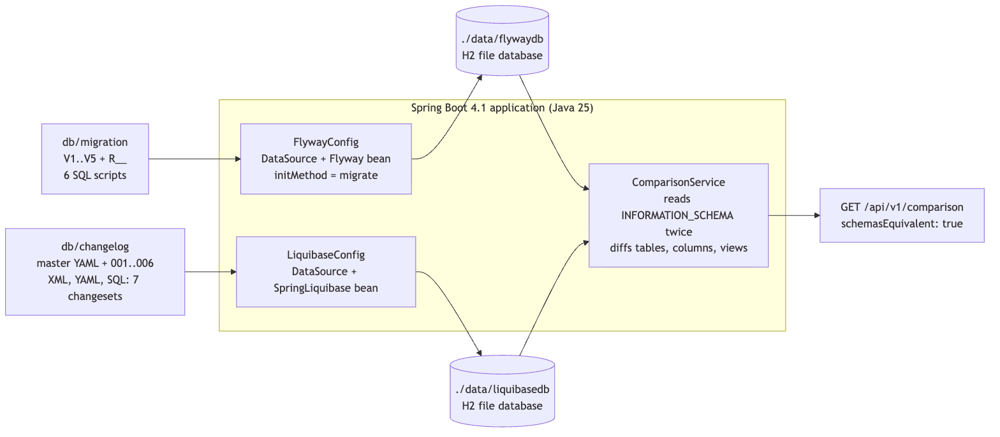
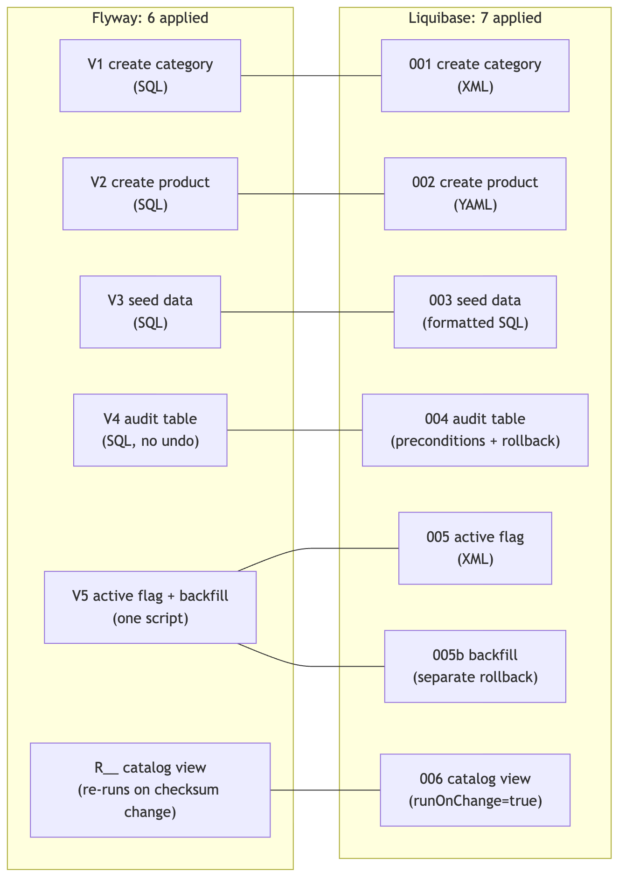

<!-- _class: lead -->
<!-- _footer: '' -->
<!-- _paginate: false -->

# Flyway vs Liquibase

## Same Schema, Two Engines, One Measured Diff

**Wallace Espindola**, Solution Architect

<wallace.espindola@gmail.com>
linkedin.com/in/wallaceespindola | github.com/wallaceespindola

<!--
Flyway versus Liquibase. Both tools solve the same problem, both are mature, and most comparisons you read online come from someone who only ever used one of them.
So this talk is backed by a running application instead. One Spring Boot process (Java 25, Spring Boot 4.1.2, plain JDBC) opens two independent H2 databases. Flyway migrates one, Liquibase migrates the other, and the app reads both back from INFORMATION_SCHEMA and diffs them at runtime.
Everything on the slides is code from that repository or a value the running app returned. I am not going to tell you which tool to pick. I am going to show you which trade-offs you are buying.
-->

---

# The problem: schema drift

- Application code is versioned and reviewed; the schema **often is not**
- "Run this script on prod" in a chat is not a deployment process
- Dev has the column, staging does not, prod has it with **another type**
- Nobody can say which changes a database **has actually seen**

The root cause: DDL treated as an operational act instead of source code.

<!--
Everybody in the room has lived this. The failure is not a dramatic outage, it is slow. You stop trusting that staging looks like production, so you stop testing there, so defects reach users.
And when someone asks "which changes has this database actually seen?", nobody can answer without reading the data.
Two things are missing: an ordered, reviewable record of every change, and a machine that applies exactly that record to every environment.
-->

---

# What any migration tool must give you

1. **Ordering**: changes apply in a defined sequence, once, everywhere
2. **Bookkeeping**: a table in the database records what ran
3. **Integrity**: a checksum catches edits to applied changes
4. **Automation**: migrations run at startup or in the pipeline

Flyway and Liquibase both deliver all four. The rest of this talk is about how.

<!--
Treat these four as the baseline, not the differentiator. A tool that fails one of them is not a candidate.
The checksum is the one people underrate. Both tools hash applied changes, so editing a migration that already ran fails validation at startup instead of drifting silently. That turns a whole class of "works on my machine" incidents into a clear error message.
-->

---

# Flyway: the filename is the configuration

- `V1__create_category_table.sql`: **V** versioned, **1** order, rest is the description
- `R__` marks a **repeatable** migration, re-applied when its checksum changes
- Scan a location, sort by version, run what `flyway_schema_history` lacks
- Raw SQL in the **target dialect**, no abstraction layer

No changelog file, no include list: discovery is a directory scan plus an ordering rule.

<!--
Flyway's model fits on one slide, which is itself the point. Convention over configuration in the most literal sense.
R__ files have no version number. Flyway re-runs them whenever the file content changes, which is what you want for views and stored procedures: objects you redefine rather than version.
-->

---

# Bootstrapping Flyway

```java
@Bean(name = "flyway", initMethod = "migrate")
public Flyway flyway(@Qualifier(DATA_SOURCE) DataSource dataSource) {
    return Flyway.configure()
            .dataSource(dataSource)
            .locations(locations)
            .baselineOnMigrate(baselineOnMigrate)
            .validateOnMigrate(true)
            .cleanDisabled(true)
            .load();
}
```

`config/FlywayConfig.java` (log line trimmed)

<!--
This is from FlywayConfig in the repo. A handful of builder calls and the engine is live, and initMethod = "migrate" runs it while the Spring context starts.
validateOnMigrate(true) is the checksum enforcement. cleanDisabled(true) blocks the destructive clean command, which you want switched off anywhere that is not a laptop.
That brevity is Flyway's core value proposition, and it is hard to argue with.
-->

---

# Liquibase: changesets in a declared changelog

- A **changeset** is the unit: `id` + `author` + file identify it
- XML, YAML, JSON or SQL, all first-class and **mixable**
- A **master changelog** lists every file: order is declared, not inferred
- Abstract tags; Liquibase emits the **dialect at runtime**
- Per changeset: `preConditions`, `context`, `labels`, `rollback`, `runOnChange`

The abstraction is the product: it buys portability and costs review readability.

<!--
Liquibase models the same problem one level up. You write createTable, not CREATE TABLE, and Liquibase decides what H2, PostgreSQL or Oracle should receive.
That is what unlocks portability, and it is also what makes a pull request harder to review for someone who only reads SQL.
The per-changeset attributes on the last bullet come back later: preconditions, contexts and rollback are where Liquibase earns most of its wins.
-->

---

# Bootstrapping Liquibase

```java
@Bean("liquibase")
public SpringLiquibase liquibase(@Qualifier(DATA_SOURCE) DataSource dataSource) {
    SpringLiquibase liquibase = new SpringLiquibase();
    liquibase.setDataSource(dataSource);
    liquibase.setChangeLog(changeLog);
    liquibase.setContexts(contexts);
    liquibase.setDefaultSchema(defaultSchema);
    liquibase.setDropFirst(false);
    liquibase.setShouldRun(true);
    return liquibase;
}
```

`config/LiquibaseConfig.java` (log line trimmed)

<!--
More knobs than Flyway, and that is not an accident. An abstract model has to be told what to include, in which context and against which schema. Here the changelog is db.changelog-master.yaml and the context is "demo".
SpringLiquibase implements InitializingBean, so the changelog is applied in afterPropertiesSet(): the same lifecycle position as Flyway's migrate().
-->

---

<!-- _class: diagram -->

# The experiment: two databases, one schema



Each engine owns its own H2 file. Neither ever touches the other.

<!--
This design is what makes the result trustworthy. One JVM, two H2 files: ./data/flywaydb and ./data/liquibasedb. Two configuration classes, each owning its own DataSource, its own migration runner and its own JdbcTemplate.
DataSourceAutoConfiguration is excluded on purpose, so there is no auto-configuration hiding the real bootstrap of each tool. On Spring Boot 4 that class now lives in the spring-boot-jdbc module, under org.springframework.boot.jdbc.autoconfigure.
At the end, ComparisonService reads both schemas from INFORMATION_SCHEMA. It never trusts the migration scripts; it reads what the databases actually contain.
-->

---

# No query before the migration finishes

```java
@Bean(JDBC_TEMPLATE)
@Primary
@DependsOn("flyway")
public JdbcTemplate flywayJdbcTemplate(@Qualifier(DATA_SOURCE) DataSource dataSource) {
    return new JdbcTemplate(dataSource);
}
```

`config/FlywayConfig.java`; the Liquibase side uses `@DependsOn("liquibase")`

- Two of every JDBC bean, so `@Qualifier` is **not optional**
- Remove `@DependsOn` and a query can hit an **unmigrated** database

<!--
With two DataSources and two JdbcTemplates, Spring cannot guess. Every injection point carries a qualifier, and the Flyway side is marked @Primary.
@DependsOn is the ordering guarantee. Without it there is a race where a service reads a database before its engine has run. With it, a migration failure aborts the context refresh, so Tomcat never starts against a half-migrated database.
-->

---

<!-- _class: diagram -->

# A paired translation table: 6 vs 7



`V5` does column and backfill in one script; Liquibase splits them into `005` and `005b`.

<!--
Every Flyway migration has a deliberate Liquibase counterpart. V1 is raw SQL against 001 in portable XML. V2 against 002 in YAML. V3 against 003, a Liquibase formatted SQL changelog. V4 against 004 with preconditions and rollback. R__ against 006 with runOnChange.
Count carefully: six Flyway migrations, seven Liquibase changesets. 005 splits the schema change from the data backfill, with different labels (schema-evolution and data-backfill) and separate rollbacks, so they can be selected independently.
The seed data goes through a versioned migration on both sides, so it applies exactly once per environment, in order. For reference data that is the right call.
-->

---

# The same table: V1 SQL vs 001 XML

```sql
CREATE TABLE category
(
    id          BIGINT AUTO_INCREMENT PRIMARY KEY,
    name        VARCHAR(100) NOT NULL,
    CONSTRAINT uk_category_name UNIQUE (name)
);
```

```xml
<createTable tableName="category">
  <column name="id" type="BIGINT" autoIncrement="true">
    <constraints primaryKey="true" primaryKeyName="pk_category" nullable="false"/>
  </column>
  <column name="name" type="VARCHAR(100)">
    <constraints nullable="false" unique="true" uniqueConstraintName="uk_category_name"/>
  </column>
</createTable>
```

<!--
Code: V1__create_category_table.sql on top, 001-create-category-table.xml below, both trimmed to the id and name columns.
Same table, two philosophies, and the trade-off shows in the character count.
The SQL is shorter and every reviewer in your organisation already reads it. The XML is longer and asks the reviewer to know what the tags emit. In exchange it names its constraints explicitly and it is not bound to H2.
AUTO_INCREMENT is H2 and MySQL syntax; PostgreSQL wants GENERATED ALWAYS AS IDENTITY. autoIncrement="true" produces the right thing on either.
Directness versus abstraction. Neither one is free.
-->

---

# Flyway V5: the expand step in plain SQL

```sql
ALTER TABLE product
    ADD COLUMN active BOOLEAN NOT NULL DEFAULT TRUE;

UPDATE product
SET active = FALSE
WHERE stock_quantity = 0;

CREATE INDEX idx_product_active ON product (active);
```

`V5__add_product_active_flag.sql` (header comment trimmed)

- Readable in five seconds, **no extra vocabulary**
- No way to undo it in Community: reverting means writing `V6`

<!--
This is the ergonomic argument for Flyway. Add the column, backfill it, index it: the classic expand step of an expand and contract rollout, one logical change in one migration.
Anyone who reads SQL can review it with no extra vocabulary. There is nothing between the intent and the statement the database executes.
Now notice what is absent: any way to undo it. Flyway Community has no undo. Reverting means writing a new forward migration. Hold that thought.
-->

---

# Liquibase 004: preconditions and rollback

```xml
<changeSet id="004-add-product-audit-table" author="wallaceespindola" context="demo">
    <preConditions onFail="MARK_RAN"
                   onFailMessage="product table missing, skipping audit table">
        <tableExists tableName="product"/>
    </preConditions>

    <comment>Add the product audit trail, guarded by a precondition</comment>

    <createTable tableName="product_audit"> ... </createTable>

    <rollback>
        <dropIndex tableName="product_audit" indexName="idx_product_audit_product"/>
        <dropTable tableName="product_audit"/>
    </rollback>
</changeSet>
```

`004-add-product-audit-table.xml` (columns, index and backfill trimmed)

<!--
Two capabilities here, and Flyway Community has neither.
First, preconditions. If the product table is missing, the changeset is marked as ran instead of failing halfway through a deploy. onFail has several modes (MARK_RAN, CONTINUE, HALT, WARN), so you choose the failure semantics per changeset. Flyway's answer would be defensive SQL or a Java migration.
Second, rollback. It makes rollbackCount 1 a supported, testable operation. Liquibase infers rollbacks for most structural changes, but declaring them keeps the intent visible.
Gotcha that already cost a debug cycle in this repo: the XML schema enforces element order. preConditions must come before comment and the change tags, or the changelog fails to parse at startup.
-->

---

# What each engine records

| | `flyway_schema_history` | `DATABASECHANGELOG` |
|---|---|---|
| Identity | `version`, one ordered namespace | `id` + `author` + `filename` |
| Author | not recorded | mandatory |
| Checksum | CRC32 | MD5 |
| Execution time | **milliseconds per migration** | **not recorded** |
| Contexts, labels, deployment id | n/a | recorded |
| Locking | database-level lock | `DATABASECHANGELOGLOCK` table |

Flyway tells you which migration is slow. Liquibase tells you who wrote it.

<!--
This is what the two tables actually contain in the running demo. Two rows point in opposite directions.
Flyway records execution time per migration. Liquibase persists no per-changeset duration, so the API returns "executionTimeMs": null on that side. Jackson keeps nulls on purpose: that null is a finding.
Liquibase records author, contexts, labels and a deployment id. Flyway's attribution lives only in git. If your auditors want to see who changed the schema without leaving the database, Liquibase answers that.
-->

---

# Reading the history: an API vs a table

```java
MigrationInfo[] all = flyway.info().all();
```

`service/FlywayHistoryService.java`: applied and pending, ordered, as objects

```sql
SELECT ID, AUTHOR, FILENAME, DATEEXECUTED, ORDEREXECUTED, EXECTYPE,
       MD5SUM, DESCRIPTION, COMMENTS, CONTEXTS, LABELS, DEPLOYMENT_ID
FROM DATABASECHANGELOG
ORDER BY ORDEREXECUTED
```

`service/LiquibaseHistoryService.java`: SpringLiquibase exposes no status object, so query the table

<!--
This finding surprised me most while building the demo, and it matters if you embed the engine in an application.
flyway.info() hands you objects: applied and pending, already ordered, with state and checksum. FlywayHistoryService is essentially a stream over that array.
Liquibase does have a status API, getChangeSetStatuses on the Liquibase class, but it needs an instance built from the changelog and a connection, and SpringLiquibase does not expose one. So LiquibaseHistoryService runs a JdbcTemplate query against DATABASECHANGELOG. It works, and that table has more columns than Flyway's, but you are now coupled to Liquibase's internal table shape.
Both classes implement the same MigrationHistoryProvider interface. The asymmetric implementations are a finding, not an accident.
-->

---

# The measured result

```json
"schemasEquivalent": true,
"schemaDifferences": []
```

`GET /api/v1/comparison` on the running application

- Both sides: `category`, `product`, `product_audit`, view `v_product_catalog`
- Columns compared as `TABLE.COLUMN:TYPE`: **zero differences**
- Indexes deliberately ignored: H2 names constraint-backing indexes differently

Same schema either way. The choice is about process, not outcome.

<!--
This is the beat of the talk. Pause after schemasEquivalent: true.
Six Flyway migrations and seven Liquibase changesets land on the same business schema: tables, views and columns with their data types all match.
Be precise about what is compared. The diff covers tables, views and columns. Indexes are excluded because H2 auto-generates constraint-backing indexes under names that differ between engines; including them would report noise as drift. That exclusion is documented in ComparisonService, not hidden.
The only real difference is bookkeeping: flyway_schema_history on one side, DATABASECHANGELOG and DATABASECHANGELOGLOCK on the other.
The integration test asserts this, so if someone adds a migration to one side only, the build fails.
-->

---

# 18 capabilities, scored

| Edge | Capabilities |
|---|---|
| Flyway (6) | learning curve, discovery, review ergonomics, merge conflicts, execution timing, status API |
| Liquibase (8) | change formats, portability, rollback, conditional execution, drift diff, bookkeeping, authorship, licensing of advanced features |
| Tie (4) | repeatable changes, concurrency, Spring Boot integration, checksums |

Flyway wins where humans read changes. Liquibase wins where machines run them across environments.

<!--
The full matrix lives in FeatureMatrix.java and is served live at /api/v1/comparison/features, with both engines' behaviour per row. Everything except the Edge column is factual; the Edge column is my judgement, labelled as such.
Do not narrate all eighteen rows. The pattern is the point: Flyway takes the rows about people writing and reviewing changes, Liquibase takes the rows about machines executing them in varied environments.
Spring Boot integration is a tie people get wrong: both are auto-configured, both run before JPA, both are one property block from working. This demo bypasses auto-configuration on purpose.
-->

---

# Rollback: matters less than the marketing says

- Flyway Community: no undo, revert with a **new forward migration**
- Flyway undo exists only in the **paid editions**
- Liquibase: `<rollback>` sits next to the change; `rollbackCount 1` is supported
- In production, rolling back after data is written **destroys data**
- Rollback pays off in **pre-production**: rehearsals, resets, local iteration

Expand, migrate, contract makes forward-only recovery viable on either tool.

<!--
The honest answer: rollback matters less than the marketing suggests, and more than zero.
Most production incidents are not fixed by rolling the schema back. Once data is written against the new shape, an automated rollback destroys it. Plenty of strong teams run Flyway Community indefinitely without missing undo.
Where rollback earns its keep is before production: resetting a test environment to a known point, rehearsing a release, iterating on a changeset locally. Running rollbackCount 1 instead of rebuilding the database is a real productivity gain.
On Flyway, undo migrations are a paid-edition feature, and Enterprise can generate them for you. Check Redgate's current feature summary for which tiers include it.
-->

---

# Licensing changed in 2025

- **Liquibase 5.0**: Community moved from Apache 2.0 to the **Functional Source License**
- FSL converts to Apache 2.0 after two years; Liquibase calls it **source available**
- Contributors now sign a **CLA**; the commercial product is **Liquibase Secure**
- **Flyway**: undo, dry-run and drift detection stay in the **paid editions**

Run your legal review on the version you ship, not on the one you remember.

<!--
This slide is new since the first version of this talk, and it changes procurement conversations.
Liquibase 5.0, announced on 30 September 2025, moved Liquibase Community from Apache 2.0 to the Functional Source License, FSL-1.1-ALv2. Each release converts to Apache 2.0 after two years. Liquibase's own FAQ calls it source available, not OSI open source. The commercial product, formerly Liquibase Pro, is now Liquibase Secure, and contributors sign a CLA.
For most teams using Liquibase inside their own application, FSL changes little in practice. For anyone building a competing product or with a strict OSI-only policy, it matters.
On the Flyway side nothing changed in that direction: Community stays open, and undo, dry-run and drift detection are paid features.
Sources: liquibase.com blog "Liquibase Community for the future: FSL", the Liquibase 5.0 release notes, and Redgate's Flyway feature summary.
-->

---

# Portability is real, and bounded

```yaml
- sql:
    comment: Check constraints have no portable Liquibase tag, so raw SQL is used here
    sql: >-
      ALTER TABLE product ADD CONSTRAINT ck_product_price_positive CHECK (price >= 0);
      ALTER TABLE product ADD CONSTRAINT ck_product_stock_non_negative CHECK (stock_quantity >= 0)
```

`002-create-product-table.yaml` (trimmed)

- Portable only while you stay **inside the tag vocabulary**
- How many times has your team **changed database engine**?

<!--
Liquibase's portability is real: autoIncrement="true" becomes whatever the target needs. Flyway scripts are the target dialect and you would rewrite them.
But it is bounded, and the repo shows exactly where. In 002 the table, columns and indexes are portable tags; the two check constraints are a raw SQL block, because there is no portable tag for them. Every real Liquibase project has files like this.
Then ask the room: how many times has your team changed database engine? For most product teams the answer is zero, and portability pays rent it never earns. For a vendor shipping onto whatever database the customer runs, it is the reason to pick Liquibase.
If you are running long, cut this slide first.
-->

---

# Review and merge conflicts

- Flyway diffs are **SQL**: every reviewer already reads them
- Two branches adding `V6__` **collide on the filename**: loud and immediate
- Liquibase diffs are **tags**: reviewers must know what each one emits
- Two branches appending to the master changelog conflict in the **include list**
- Git can auto-merge that list in the **wrong order**; nothing fails until deploy

If your team is large and merges often, weigh this row heavily.

<!--
This is the daily cost rather than the feature list, and it changes more minds than the matrix does.
The Flyway conflict is the good kind of failure: it happens at merge time, it is obvious, and the fix is renaming a file. A CI check for unique version numbers is cheap.
The Liquibase conflict is the bad kind: syntactically valid, semantically wrong, found later. The mitigations are real (one changelog file per release, or includeAll on a directory), but they are conventions your team has to adopt and enforce.
-->

---

# Choose Flyway when

- You target **one database** and expect to keep it
- Your team is fluent in SQL and wants **diffs it can read at a glance**
- **Forward-only** migration fits your release process
- You want the smallest thing between **intent and executed statement**

The most common mistake on the other side: buying portability you never use.

<!--
Flyway optimises for the common case: one database, a SQL-literate team, forward-only releases.
The mistake that pushes teams the wrong way is picking Liquibase for portability they will never exercise, and paying the review-ergonomics cost every day for it.
-->

---

# Choose Liquibase when

- You ship to **several database engines**, or customers pick the engine
- You need **rollback, preconditions or contexts** as first-class features
- Auditors want **author and deployment id** inside the database
- You want **diff and rollback** without a commercial licence, under FSL terms

Whichever you pick: use it for everything, and never apply DDL by hand again.

<!--
Liquibase optimises for variability: many databases, many environments, changes that must be conditional or reversible.
The mistake on this side is picking Flyway Community and discovering later that undo and drift detection sit in the paid editions. On the Liquibase side, check that FSL fits your organisation's licence policy.
And the decision that matters more than the name: pick one, use it for every environment, and stop applying DDL by hand.
-->

---

# Run it yourself

```bash
git clone https://github.com/wallaceespindola/flyway-vs-liquibase-db-migrations
cd flyway-vs-liquibase-db-migrations
mvn spring-boot:run
```

| Endpoint | Shows |
|---|---|
| `/api/v1/comparison` | full report with `schemasEquivalent` |
| `/api/v1/comparison/features` | the 18-row feature matrix |
| `/api/v1/migrations` | both engines' history side by side |
| `/swagger-ui.html`, `/h2-console` | API docs and both databases |

<!--
Clone it and run it: Java 25, Maven, no Docker, no external database. H2 writes two files into ./data. Engine versions come from the Spring Boot 4.1.2 BOM: Flyway 12.4.0, Liquibase 5.0.4, H2 2.4.240. Flyway logs a warning that H2 2.4.240 is newer than the H2 version it was verified against; everything works.
Hit /api/v1/comparison first and scroll to schemasEquivalent.
Then open /api/v1/migrations and compare the raw JSON: Flyway entries carry executionTimeMs and an author of "n/a"; Liquibase entries carry a real author and a null executionTimeMs.
The H2 console connects to jdbc:h2:file:./data/flywaydb and ./data/liquibasedb, user sa with an empty password, if you want to see both bookkeeping tables yourself.
The repo has 86 tests at 98.8% line coverage behind an 80% JaCoCo gate.
-->

---

<!-- _class: lead -->
<!-- _footer: '' -->
<!-- _paginate: false -->

# Thank You

## Which tool does your team run, and which row decided it?

[github.com/wallaceespindola/flyway-vs-liquibase-db-migrations](https://github.com/wallaceespindola/flyway-vs-liquibase-db-migrations)

**Wallace Espindola**, Solution Architect
linkedin.com/in/wallaceespindola | speakerdeck.com/wallacese

<!--
One sentence to take away: both tools produce the same schema, so choose on process, not on outcome.
Clone the repo, run it, and disagree with my Edge column. The matrix is one Java file and pull requests are welcome.
Questions to expect:
- "Can I migrate from Flyway to Liquibase, or back?" Yes. Liquibase can generate a changelog from an existing database and mark everything so far as already run; going the other way, you baseline Flyway at the current schema.
- "Can I use both?" Technically, with separate schemas. Don't: two mental models and two bookkeeping tables for one problem.
- "Does any of this depend on Spring Boot?" No. Both have Maven, Gradle and CLI interfaces.
- "What about Flyway Java migrations?" Useful for changes SQL cannot express; they do not change the portability or rollback story.
- "Does the Liquibase licence change affect me?" Only if you build a competing product or your policy requires OSI licences; check FSL-1.1-ALv2 with your legal team.
Timing: about 30 minutes for 25 slides. Non-negotiable slides if you must cut: the experiment diagram, the measured result and the two decision slides.
-->
